<div align="center">

# AI Principal Architect — v2.2.0

**Turn an idea — or an existing repository — into a verified, low-token agent package that coding agents can build from.**

[](https://github.com/furkanarslangray-design/architect-studio/actions/workflows/ci.yml)
[](.nvmrc)
[](README.md#tests)
[](https://nx.dev)
[](pnpm-lock.yaml)
[](LICENSE)
[](https://m8ven.ai/mcp/furkanarslangray-design-architect-studio-hx6k8f?s=readme)

> **Language / Dil:** [English](README.md) | [Türkçe](README.tr.md)

</div>

An open-source, BYOK-based tool that turns an idea (or an existing project) into a
**verified agent package** that coding agents such as OpenCode, Cursor and Claude can
build from with a low token budget.

- **Idea → architecture → package.** One pipeline: `ArchState` in, deterministic
  artifacts, task packets and a ZIP out.
- **Local-first.** The server binds `127.0.0.1` by default and the only network call is
  the LLM request you configure (demo mode needs none).
- **No UI in this repository.** The Studio front end is written separately against
  [`FRONTEND_SPEC.md`](FRONTEND_SPEC.md); this repo is the API, CLI, MCP server and
  library.

## Contents

| Section | What it answers |
|---|---|
| [System architecture](#system-architecture) | How the pieces fit together (diagrams) |
| [Requirements and installation](#requirements-and-installation) | Node, pnpm/npm/yarn/bun, one-time setup |
| [Quick start](#quick-start) | The five commands you need |
| [Pipeline](#pipeline) | What happens between an idea and a ZIP |
| [CLI](#cli) | Every subcommand and flag |
| [HTTP API](#http-api) | Endpoints, payloads, error codes |
| [Reverse engineering](#reverse-engineering-rea) | Repository analysis, REA bridge, cache, SSE |
| [Projects and revisions](#projects-and-revisions-sqlite) | Persistence, locking, `projects` CLI |
| [Sandbox drivers](#sandbox-drivers) | Isolated verification |
| [MCP server](#mcp-server) | Tools for coding agents |
| [Configuration](#configuration) | Environment variables in one table |
| [Tests](#tests) | What is verified and how to run it |
| [Security posture](#security-posture) | Boundaries, dependency fixes |
| [Versioning policy](#versioning-policy) | Where the version lives and why README matches code |
| [Troubleshooting](#troubleshooting) | Known failure modes |

## System architecture

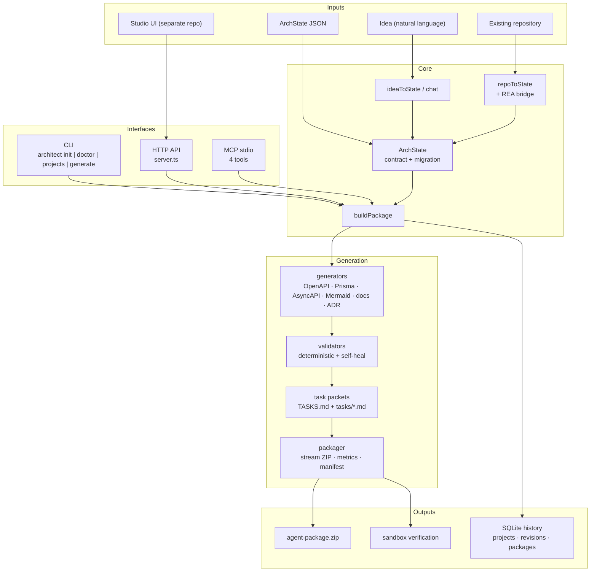

The two interfaces share one pipeline (`packages/app/src/pipeline.ts`); the CLI and the
HTTP server therefore produce byte-identical packages for the same input.

### Request lifecycle

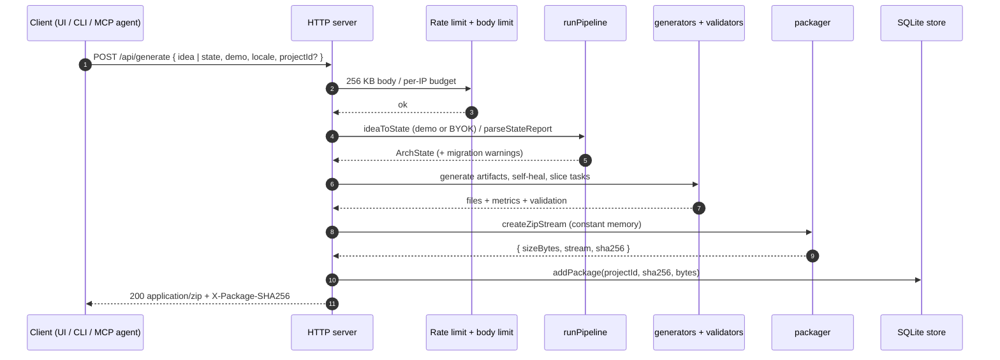

## Requirements and installation

| Requirement | Version | Where it is pinned |
|---|---|---|
| Node.js | **24.22.1** | `.nvmrc`, `package.json` → `devEngines.runtime` |
| Node.js range | `^22.23.4 \|\| ^24.22.1 \|\| >=26.12.1` | `package.json` → `engines.node` |
| pnpm | 10 | `pnpm-lock.yaml`, CI (`pnpm/action-setup@v4`) |
| OS | Linux, macOS, Windows | Sandbox drivers are optional and auto-detected |

This is a **source checkout**, not a registry package: the root `package.json` is
`private: true` and no `bin` entry is published, so install it by cloning. Two supported
package-manager paths:

### pnpm — the reference path

```bash
git clone https://github.com/furkanarslangray-design/architect-studio.git
cd architect-studio
pnpm install            # installs the workspace and downloads the pinned Node when needed
pnpm exec node -v       # v24.22.1
```

`pnpm` is the only manager that understands `pnpm-workspace.yaml` and
`pnpm-lock.yaml`, and CI runs `pnpm install --frozen-lockfile`. Use it unless you have a
reason not to.

### npm — supported for running an existing checkout

All runtime and development dependencies live in the **single root** `package.json`; the
`packages/*` manifests declare no dependencies of their own. That flat layout is what makes
npm usable for a checkout:

```bash
git clone https://github.com/furkanarslangray-design/architect-studio.git
cd architect-studio
npm install                       # one dependency tree at the root
npm run typecheck                 # nx run-many -t typecheck
npm run test                      # nx run-many -t test
npm run dev                       # nx run app:dev → http://127.0.0.1:3000
npm run architect -- projects list
```

| pnpm script | npm equivalent |
|---|---|
| `pnpm install` | `npm install` |
| `pnpm dev` / `pnpm start` | `npm run dev` / `npm run start` |
| `pnpm test` / `pnpm typecheck` | `npm test` / `npm run typecheck` |
| `pnpm architect <args>` | `npm run architect -- <args>` |
| `pnpm generate -- <args>` | `npm run generate -- <args>` |
| `pnpm mcp` | `npm run mcp` |
| `pnpm nx <target>` | `npx nx <target>` |

Notes on the npm path:

- Keep `pnpm-lock.yaml` as the lockfile. `npm install` writes `package-lock.json`; do not
  commit it — the repo is a pnpm workspace and CI installs from the pnpm lockfile.
- `devEngines.runtime` is a pnpm feature, so an npm script runs under the `node` on your
  `PATH`. If that is outside the supported range, use `nvm use` / `fnm use` first — the
  REA bridge otherwise falls back to the static analyzer.
- Yarn and Bun run the same root scripts (`yarn install && yarn dev`,
  `bun install && bun run dev`); `tsx` and `nx` are the only entry points involved.

### After installing

```bash
pnpm architect init .   # .architect/config.json + client MCP files + AGENTS.md block
cp .env.example .env    # optional: HOST, PORT, ARCHITECT_DB, REVERSE_ROOTS
```

`pnpm architect init .` is idempotent: a second run reports `unchanged` for every file and
only rewrites its own `<!-- architect:start --> … <!-- architect:end -->` block in
`AGENTS.md`.

## Quick start

```bash
pnpm install
pnpm dev                # nx run app:dev → http://127.0.0.1:3000
pnpm test               # nx run-many -t test
pnpm typecheck          # nx run-many -t typecheck
pnpm nx graph --host 127.0.0.1 --port 4211   # live project graph
```

Demo mode is on by default and needs no API key. The first useful command is usually:

```bash
pnpm generate -- --idea "Postgres, Redis events, React storefront" --demo --extract out/package
```

## Pipeline

1. **State.** A natural-language idea becomes an `ArchState` (`ideaToState`), an existing
   JSON is parsed and migrated (`parseStateReport`), or a repository is analysed
   (`repoToState`). Optional web search enriches the prompt first.
2. **Generation.** OpenAPI 3.1 (entity CRUD), Prisma, AsyncAPI 2.6, a Mermaid diagram,
   `ARCHITECTURE.md`, `WHITEPAPER.md` and ADRs are produced from the state alone.
3. **Validation.** Every artifact is checked deterministically; repairable issues are fixed
   without an LLM, and the remaining issues are reported.
4. **Slicing.** Work becomes a `TASKS.md` index plus self-contained `tasks/T-*.md` packets
   with dependency waves and token budgets.
5. **Packaging.** `metrics.json`, `MANIFEST.md`, `.opencode/agents/*.md` and the artifacts
   are streamed into a ZIP with constant memory and a stable hash.
6. **Verification (optional).** The package is checked inside an isolated sandbox driver.

### Capabilities

| Capability | Summary |
|---|---|
| **Stream ZIP** | Node `Readable` + backpressure; the archive is never buffered whole. A 24 MB package profile is verified in tests. |
| **8 languages** | `tr`, `en`, `de`, `es`, `fr`, `pt`, `ja`, `zh`; API errors and generated documents follow the selected language. |
| **Studio contract** | No UI code lives in the repo; 11 screens, the component/interaction list, design tokens and the full API contract are in [`FRONTEND_SPEC.md`](FRONTEND_SPEC.md). |
| **REA** | `repoToState` derives an `ArchState` from `package.json`, workspaces, Prisma, `docker-compose`, ADRs and component files; an optional `morluto/rea` bridge adds binary/bundle findings. |
| **Multi-Sandbox** | `temp-dir`, `bwrap`, `podman`, `docker`, `firejail`, `systemd-run`; auto-detection and safe fallback. |
| **Projects** | SQLite-backed project, revision and package history with a WAL database that several processes can write to. |
| **MCP** | `architect_generate`, `architect_preview`, `architect_validate`, `architect_reverse_engineer`. |
| **Web search** | Fresh references through Tavily/Brave keys or a keyless DuckDuckGo fallback. |
| **Nx monorepo** | 9 projects, cached `test`/`typecheck` through `nx run-many`, an `nx graph` architecture map and a local `package` generator. |

### Node version and the REA launcher

The `rea-agents` launcher requires Node **`^22.23.4 || ^24.22.1 || >=26.12.1`** in its own
`engines` field; outside those versions the REA bridge does not run and `rea.engine`
silently falls back to `static`. The requirement is therefore pinned at the repository
level:

| Location | Value |
|---|---|
| `.nvmrc` | `24.22.1` |
| `package.json` → `engines.node` | `^22.23.4 \|\| ^24.22.1 \|\| >=26.12.1` |
| `package.json` → `devEngines.runtime` | `node 24.22.1` (`pnpm runtime set node 24.22.1 -D`) |
| `.github/workflows/ci.yml` | `actions/setup-node` → `node-version-file: .nvmrc` |

```bash
pnpm install                # also downloads the pinned runtime when needed
pnpm exec node -v           # v24.22.1 — scripts always use the project runtime
```

`devEngines.runtime` means `pnpm <script>` runs under 24.22.1 even when the system `node`
is older, so the REA bridge works without changing the machine-wide Node. `nvm install &&
nvm use` still works for an interactive shell. If neither is possible, skip the REA bridge
(run without `useRea`, `rea.engine: "static"`) or point `ARCHITECT_REA_BIN=/path/to/rea` at
a launcher that runs under a supported Node.

### BYOK

The client disables demo mode; the API key, model and OpenAI-compatible base URL travel in
the request body (`apiKey`, `model`, `baseUrl`). The key is used only for that request; it
is not written to disk, never logged and never placed in the package.

## CLI

```bash
pnpm architect init [dir] [--client cursor|claude|opencode|freebuff|all] [--force]
pnpm architect doctor [dir] [--state <path>] [--json] [--fail-on-drift] [--write]
pnpm architect projects list|show|save|restore [--db <path>]
pnpm generate -- --idea "<text>" [flags]
```

### `architect init`

Connects a target repo to the MCP server in one command:

```bash
pnpm architect init .                     # all clients
pnpm architect init . --client opencode   # a single client
pnpm architect init . --force             # overwrite existing files
```

It writes `.architect/config.json` (client, MCP command, `reverseRoots`, package/test
runner), `.cursor/mcp.json`, `.mcp.json`, `opencode.json` and the
`<!-- architect:start --> … <!-- architect:end -->` block inside `AGENTS.md`. It never
touches files it does not own without `--force`. For Freebuff it writes no files and
leaves a note to add the server from the MCP screen.

### `architect doctor`

Compares the saved architecture (`.architect/state.json`) with the repository as it is
today:

```bash
pnpm architect doctor .                  # human-readable report
pnpm architect doctor . --json           # machine-readable report
pnpm architect doctor . --fail-on-drift  # exit 1 on drift (for CI)
pnpm architect doctor . --state out/state.json
pnpm architect doctor . --write          # write today's repo state to .architect/state.json
```

Drift types: `node`, `edge`, `entity`, `field`, `decision` × `added|removed|updated`. A
missing or corrupt state file exits **2**, a clean comparison **0**, and with
`--fail-on-drift` drift exits **1**. `validateState` errors are reported too. Limit:
generated `openapi.yaml` / `ARCHITECTURE.md` are not parsed back; the comparison is
structural and the report says so. The typical flow is `doctor --write` → edit →
`doctor --fail-on-drift`.

### `architect projects`

See [Projects and revisions](#projects-and-revisions-sqlite).

### `architect generate`

```bash
# Demo package
pnpm generate -- --idea "Postgres, Redis events, React storefront" --demo

# Package from an existing state + extract to a directory
pnpm generate -- --json examples/architecture.json --out out/package.zip --extract out/package

# Reverse engineering + sandbox verification
pnpm generate -- --reverse ../my-project --use-rea --sandbox auto --out out/reverse.zip

# Turkish output + live web search
pnpm generate -- --idea "..." --demo --locale tr --web-search --search-provider auto

# BYOK + target runtime
pnpm generate -- --idea "..." --api-key sk-... --model gpt-4o-mini \
  --package-manager npm --test-runner jest

# Preview only (writes no ZIP)
pnpm generate -- --json examples/architecture.json --preview
```

| Flag | Meaning |
|---|---|
| `--idea <text>` | Natural-language architecture idea |
| `--json <path>` | Import an existing `ArchState` file |
| `--reverse <dir>` | Derive the state from a repository |
| `--use-rea` | Bridge `morluto/rea` when installed |
| `--out <path>` | Output ZIP (default `out/agent-package.zip`) |
| `--extract <dir>` | Also write every package file into a directory |
| `--preview` | Print state, tasks, metrics and validation as JSON |
| `--demo` | Deterministic state producer, no API key |
| `--api-key`, `--base-url`, `--model` | BYOK settings, never written to disk |
| `--package-manager` | `pnpm \| npm \| yarn \| bun` for the generated package (default `pnpm`) |
| `--test-runner` | `vitest \| jest \| node` (default `vitest`) |
| `--locale` | `tr \| en \| de \| es \| fr \| pt \| ja \| zh` |
| `--sandbox`, `--sandbox-command` | Verification driver and custom command |
| `--web-search`, `--search-provider` | Reference lookup before generation |
| `--reproducible` | Zero the duration metric so hashes match across runs |

`--package-manager npm` matters for the *generated* package: the task packets then show
`npm install` / `npm test` commands instead of pnpm ones. The variable is documented per
target so a downstream agent does not mix managers.

## HTTP API

| Method | Path | Description |
|---|---|---|
| GET | `/` | `api-only` welcome JSON when no UI is bundled (`name`, `version`, `mode`, `spec`, `endpoints`) |
| GET | `/api/health` | `{ ok, version }` |
| GET | `/api/version` | Version, tokenizer and languages |
| GET | `/api/i18n?locale=tr` | Message catalog |
| GET | `/api/sandboxes` | Detected sandbox drivers |
| POST | `/api/preview` | State + diagram + files + tasks + metrics + validation |
| POST | `/api/generate` | ZIP (`application/zip`, `Content-Length` measured while streaming) |
| GET | `/api/rea` | `rea` / `rea-agents` detection (version, mode) |
| POST | `/api/chat` | `{ state, message }` → updated state, diagram, files, change list |
| POST | `/api/reverse` | `{ path, useRea? }` → `ArchState`, findings, summary, REA report |
| POST | `/api/reverse/jobs` | Same body as `/api/reverse`; `202 { jobId, status, events }` |
| GET | `/api/reverse/jobs/{id}` | Job state plus the full event history |
| GET | `/api/reverse/jobs/{id}/events` | `text/event-stream`: `scan → rea → merge → validate → done\|error` |
| GET | `/api/projects` | Projects with revision counts (`mode: file\|memory`) |
| POST | `/api/projects` | `{ name }` → `201 { project }` |
| GET | `/api/projects/{id}` | Project, revision history and package count |
| POST | `/api/projects/{id}/revisions` | `{ state, message? }` → `201 { revision }` |
| GET | `/api/projects/{id}/revisions` | Revision history, newest first (no state) |
| POST | `/api/projects/{id}/restore/{revisionId}` | Restores a revision as a new revision |
| POST | `/api/sandbox` | Verifies the package in the selected sandbox |

Shared body fields: `idea` **or** `state`, `demo`, `apiKey`, `baseUrl`, `model`,
`packageManager`, `testRunner`, `locale`, `sandbox`, `webSearch`. Request bodies are
limited to 256 KB; write endpoints are protected by a per-IP per-minute budget
(`RATE_LIMIT_PER_MIN`, default 120).

| Status | Meaning |
|---|---|
| `400` | Invalid input, state, path or sandbox (including `path_not_allowed`, `invalid_name`) |
| `403` | `reverse_disabled` — unbounded reverse on a network-facing bind |
| `413` | Body too large |
| `429` | Rate limit or `reverse_busy` queue timeout |
| `502` | LLM provider failure |
| `504` | `reverse_timeout` |

### State migration warnings

Old states are upgraded by `parseStateReport`. Warnings are surfaced instead of dropped:
`/api/preview`, `/api/chat` and `/api/sandbox` return them in `stateWarnings`,
`/api/generate` in the `X-State-Warnings` header (it streams a ZIP, so there is no JSON
body), and the CLI prints `State migration: …` on stderr so `--preview` JSON on stdout
stays machine-readable.

### UI contract (`FRONTEND_SPEC.md`)

The Studio UI is not part of this repository; its contract lives at the repo root:

- **5 sections:** product summary/flows, screen + component/interaction list, design system
  (HEX palette, typography, dark/light, layout, responsive), the full API contract, and
  error and loading states.
- **11 screens/components:** `IdeaComposer`, `ArchitectureCanvas` (Mermaid), `EntityTable`,
  `ChatPanel`, `TaskBoard`, `MetricsGrid`, `ValidationPanel`, `ArtifactExplorer`,
  `ReverseForm`, `SandboxPanel`, `SettingsDrawer`.
- Contract tests compare the endpoint list in `FRONTEND_SPEC.md` §4 with `ENDPOINTS` in
  `packages/app/src/contract.ts` in both directions; adding or removing an endpoint breaks
  the test.

The architecture chat (`POST /api/chat`) applies natural-language commands (`add Redis
cache`, `add a status field to the Order entity`, `split into microservices`) to the
`ArchState` deterministically; in BYOK mode the LLM takes over and falls back to the
deterministic engine on failure. Field insertion only triggers on an explicit field
phrase, a typed identifier or a camelCase/snake_case identifier — a sentence that merely
contains "add" is not treated as a field. Microservice splitting only runs for
`microservice(s)` or a service word plus `split|böl|ayır`.

## Reverse engineering (REA)

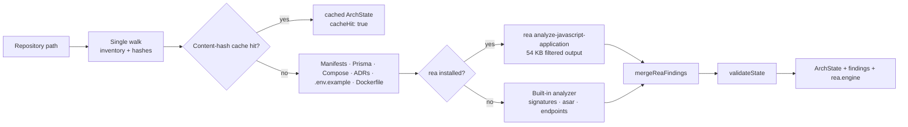

`repoToState(root)` scans:

- root and workspace `package.json` files → framework, database, queue and external
  services,
- `prisma/schema.prisma` → entities, fields, primary/unique and relations,
- `docker-compose.y(a)ml` / `compose.y(a)ml` → service, database and queue nodes,
- `docs/adr/**`, `adr/**`, `decisions/**` → ADR decisions,
- component files under `src/app|pages|components` → a UI node (when no framework is
  found).

Directories such as `node_modules`, `.git`, `dist`, `build`, `out`, `coverage`, `vendor`,
`target` and files above 512 KB are skipped. The result is validated with `validateState`
and can be packaged directly. CLI: `--reverse <dir>`, API: `POST /api/reverse`, UI:
`ReverseForm` (`FRONTEND_SPEC.md` §2.2).

### morluto/rea bridge

`--use-rea` (API `useRea: true`, MCP `useRea`) bridges to
[`morluto/rea`](https://github.com/morluto/rea):

- If `rea` or `rea-agents` is on `PATH`, it runs `rea analyze-javascript-application
  <path> --json` (`rea analyze` / `rea inspect` when needed); stdout passes through a
  54 KB `--filter-output` projection (the full envelope is ~34 MB), and REA's
  `normalized_result` document is converted into module/asset/package/endpoint/Electron
  findings.
- If REA is not installed, the built-in analyzer takes over: file signatures
  (ELF/PE/Mach-O/WASM/SQLite), the Electron `.asar` header, minified bundle signatures,
  `.env.example` key names (values are never read), the Dockerfile base image and external
  endpoints. Findings share the same `evidence` schema, so the layer above never needs to
  know which engine ran.
- Use `ARCHITECT_REA_BIN=/path/to/rea` to point at a specific installation.
- REA is slow on big trees: with the pinned runtime it analysed a two-file fixture in ~6.5 s
  (engine `rea`, 6.10.1), while this repository (153 files) exceeded a 5-minute budget.
  Keep `maxFiles`/`maxDepth` small for large targets; the bridge passes
  `REVERSE_TIMEOUT_MS` to the `rea` child process.
- The response carries `rea.engine` (`rea` | `rea-agents` | `static`), `rea.findings`,
  `rea.scannedArtifacts` and `rea.warnings`. `GET /api/rea` returns only the detection
  result.

### Incremental reverse (content-hash cache)

`repoToStateCached` keys its result by the hash of the file inventory (path, size, mtime)
plus the SHA-256 content of the files the analyzer actually reads (manifests, Prisma,
Compose, ADRs, `.env.example`, Dockerfile; ≤64 KB) plus the options that affect the result
(path base, `useRea`, `maxFiles`, `maxDepth`, `ignore`). On a hit the result is read from
`.architect/cache/reverse/<key>.json`: manifest parsing, merging, validation and the `rea`
child process are all skipped, and the response reports `cacheHit: true`.

- `POST /api/reverse { cache: false }` bypasses the cache; use `ARCHITECT_CACHE_DIR` for a
  different directory and `REVERSE_CACHE=0` to disable it. TTL is 24 hours.
- When inputs change (manifest content, an added/removed file, options) the key changes and
  the first request recomputes. `.architect/cache/` is not committed.
- **Measurement** (this machine, `tsx`): a 391-file fixture (8 Prisma models, Compose, 5
  ADRs, 380 components) went from cold **104.9 ms** to a warm median of **16.3 ms** = 6.4x;
  this repo (125 files) 60.3 ms → 9.5 ms = 6.3x.
- **CPU/RAM optimization:** a single directory walk, `mtimeMs` from the `stat` result, a
  content-digest memo (4096 entries), an in-process result memo (4 entries) and a `skipped`
  list capped at 200. Cold **110.5 → 52.9 ms**, warm **18.7 → 5.8 ms**, file reads on the
  warm path **12 → 0**, heap flat at ~11–13 MB.

### Progress stream (SSE)

`POST /api/reverse/jobs` takes the same body as `/api/reverse` and returns `202 { jobId,
status, events }`. `GET /api/reverse/jobs/<id>/events` streams `scan → rea → merge →
validate → done|error` as `text/event-stream`; the `done` event's `payload` is the full
`/api/reverse` response. `GET /api/reverse/jobs/<id>` returns the status and the whole
history; finished jobs are kept for 5 minutes. The same queue and security limits apply.

## Projects and revisions (SQLite)

`packages/app/src/store.ts` keeps projects, revisions and generated packages so a session
can be reopened where it stopped. It uses the built-in `node:sqlite` (`DatabaseSync`)
instead of `better-sqlite3`: no dependency or native build is added and the pinned Node
range already ships it.

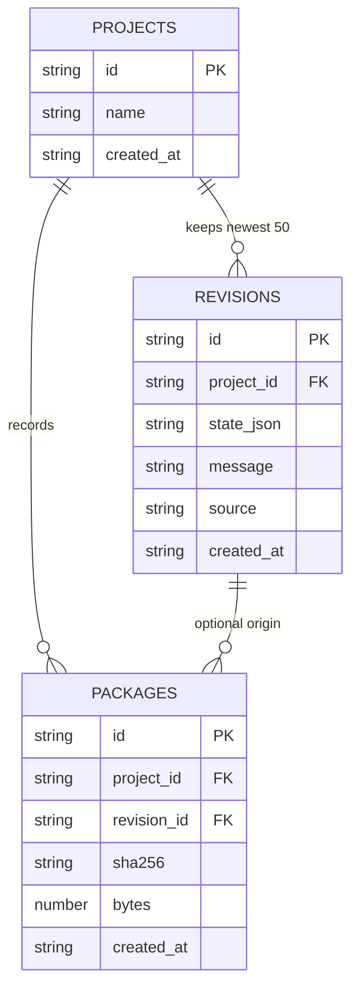

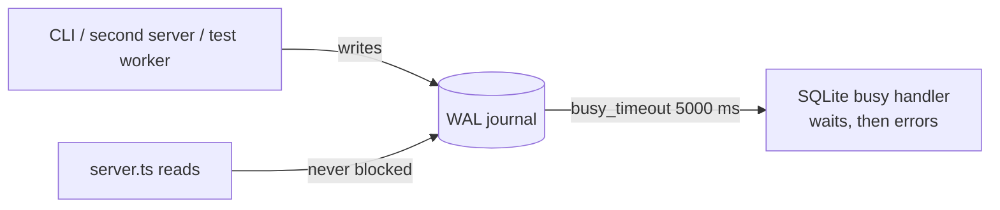

- `ARCHITECT_DB=/path/to/architect.db` opens a file; `pnpm start` / `pnpm dev` default to
  `.architect/architect.db`. Without the variable (library use and tests) the store stays
  in memory and `GET /api/projects` reports `mode: "memory"`, so the old behavior is
  unchanged.
- An unopenable path also falls back to memory instead of failing requests.
- `POST /api/generate` with `projectId` (and optional `revisionId`) records the ZIP's
  `sha256` and byte size against the project.
- **Concurrent writers:** the database opens with `journal_mode = WAL`, `synchronous =
  NORMAL` and `busy_timeout = 5000`. Waiting is left to SQLite's own busy handler — there
  is no JavaScript retry loop, so a lock conflict has exactly one place to look. A store
  test spawns two worker processes that each add ten revisions to one file and expects all
  twenty.
- `projects` CLI:

```bash
pnpm architect projects list
pnpm architect projects show <projectId>
pnpm architect projects save <projectId> state.json --message "add db"
pnpm architect projects restore <projectId> <revisionId>
pnpm architect projects list --db /tmp/other.sqlite   # overrides ARCHITECT_DB
```

`save` prints the new revision id, `restore` prints the restored state JSON, `list` prints
`id<TAB>revisionCount<TAB>name`. Exit codes match `doctor`: `0` ok, `1` usage error, `2`
missing/invalid input.

## Sandbox drivers

`packages/sandbox` exposes a modular `SandboxDriver` interface. Every driver runs the
command in an isolated temporary working directory with only safe environment variables
(`PATH`, `LANG`, `HOME`, `TMPDIR`; API keys never pass through). Commands are executed with
`spawn(file, args, { shell: false })`, so metacharacters in an argument stay literal.

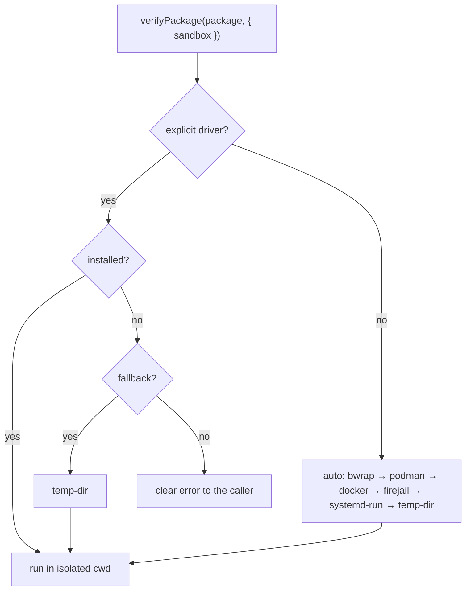

| Type | Isolation | Requirement |
|---|---|---|
| `temp-dir` | Directory + restricted env | Always available |
| `bwrap` | Linux namespaces | Bubblewrap |
| `podman` | Rootless container | Podman + a `node:22-alpine` image |
| `docker` | Container | Docker + image |
| `firejail` | Process jail | Firejail |
| `systemd-run` | Transient systemd scope | systemd user session |

CLI `--sandbox <type>` / `--sandbox-command <cmd>`, API `POST /api/sandbox` and the UI
`SandboxPanel` all use the same drivers. `GET /api/sandboxes` lists the installed engines
and their versions.

## MCP server

```bash
pnpm mcp
```

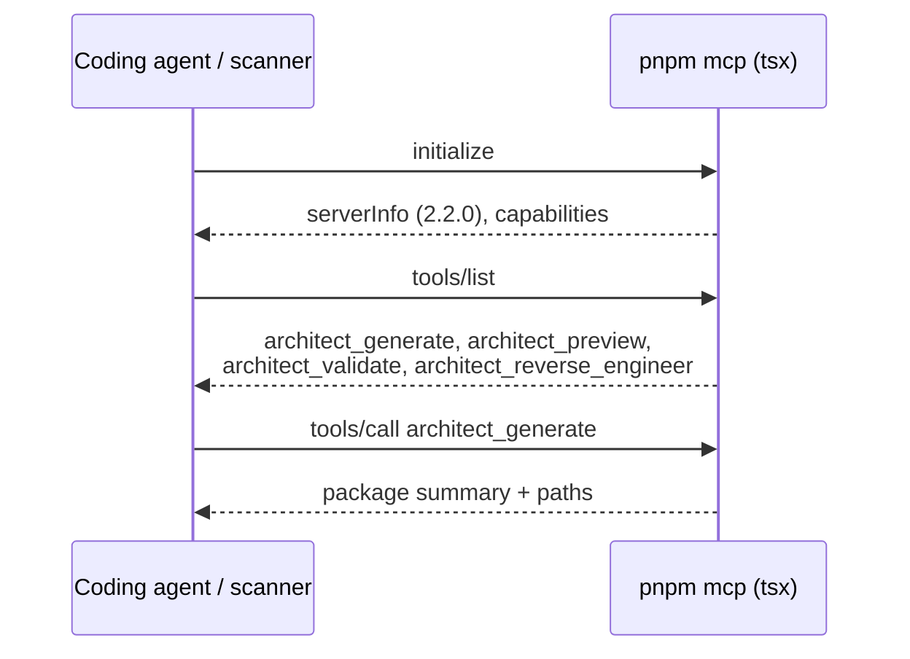

Four tools are exposed over stdio. `pnpm mcp` starts the server directly with `tsx`; no
build step is needed, and a test performs the real `initialize` + `tools/list` handshake
through `pnpm mcp` so an automated scanner sees the same tool surface. Configuration
examples for Claude Code, Cursor, OpenCode and Freebuff: [`docs/mcp.md`](docs/mcp.md).

## Web search

An optional search layer runs before `ideaToState`. With provider `auto` it uses
`TAVILY_API_KEY` or `BRAVE_API_KEY` when present, otherwise the keyless DuckDuckGo
instant-answer API. Results are added to the prompt as a context block capped at 4,000
characters. CLI `--web-search --search-provider <auto|tavily|brave|duckduckgo>`, body field
`webSearch: true`, and the `SettingsDrawer`/`IdeaComposer` toggle in the UI
(`FRONTEND_SPEC.md` §2.2).

## Language support (i18n)

The single source is `packages/core/src/i18n/locales/en.ts`; other languages are compiled
with `MessageKey` parity. The `Accept-Language` header, the body `locale` field and the CLI
`--locale` flag all use the same catalog. Missing translations fall back to English and
placeholders are preserved.

## Workspace layout

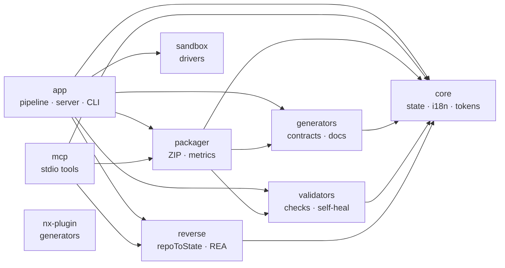

| Project | Role |
|---|---|
| `core` | state, diff, i18n, tokenizer, metrics, task packets |
| `generators` | OpenAPI / Prisma / AsyncAPI / Mermaid / document generators |
| `validators` | deterministic validation + self-heal |
| `packager` | stream ZIP, metrics, manifest, OpenCode agents |
| `app` | pipeline, chat, web search, HTTP server, CLI |
| `reverse` | `repoToState` + morluto/rea bridge |
| `sandbox` | multi-sandbox drivers |
| `mcp` | MCP tools + stdio server |
| `nx-plugin` | local Nx generators |

Every package has its own `project.json` (`typecheck`, plus `test` where applicable) and
`tsconfig.json`; shared compiler settings live in `tsconfig.base.json`.

```bash
pnpm test                      # nx run-many -t test (cached)
pnpm typecheck                 # nx run-many -t typecheck
pnpm build                     # typecheck + test
pnpm affected                  # nx affected -t typecheck test (defaultBase: main)
pnpm nx graph --host 127.0.0.1 --port 4211   # live project graph
pnpm nx graph --file=graph.html              # static graph output
pnpm nx show projects          # project list
pnpm nx run app:dev            # a single project target
```

`nx.json` sets `useDaemonProcess: false` (CI/container friendly), `analytics: false` and
`cache: true` for the `test`/`typecheck` targets. Task output lives under `.nx/`, which is
not committed. Because packages import each other by relative path
(`../../core/src/state`), Nx does not infer the edges itself; real dependencies are declared
in each `project.json` under `implicitDependencies`, and the diagram above mirrors them.

### Local Nx generator

`packages/nx-plugin` is an Nx plugin named `@architect-studio/workspace-plugin`
(`generators.json` + a path mapping in `tsconfig.base.json`). It scaffolds a new library
package with the repo's conventions (project.json targets, tsconfig, source, Vitest suite):

```bash
pnpm nx g @architect-studio/workspace-plugin:package order-flow \
  --description="Order flow orchestration"

pnpm nx g @architect-studio/workspace-plugin:package order-flow --dry-run  # no files written
```

Generated files: `packages/<name>/project.json`, `packages/<name>/tsconfig.json`,
`packages/<name>/src/index.ts`, `packages/<name>/tests/<name>.test.ts`. Invalid names (not
kebab-case) and existing package names are rejected.

## Configuration

| Variable | Default | Purpose |
|---|---|---|
| `HOST` | `127.0.0.1` | Bind address; a network bind with empty `REVERSE_ROOTS` warns and disables reverse |
| `PORT` | `3000` | HTTP port |
| `ARCHITECT_DB` | unset (memory) / `.architect/architect.db` for `pnpm dev` / `pnpm start` | SQLite file for projects and revisions |
| `ARCHITECT_CACHE_DIR` | `.architect/cache` | Reverse cache directory |
| `REVERSE_CACHE` | enabled | `0` disables the reverse cache |
| `REVERSE_ROOTS` | empty | Colon-separated allowlist for `/api/reverse` |
| `REVERSE_CONCURRENCY` | `2` | Parallel reverse jobs; extras wait in a FIFO queue |
| `REVERSE_QUEUE_TIMEOUT_MS` | `30000` | Queue budget before `429 reverse_busy` |
| `REVERSE_TIMEOUT_MS` | `120000` | Job budget before `504 reverse_timeout`, also passed to `rea` |
| `RATE_LIMIT_PER_MIN` | `120` | Per-IP write budget |
| `ARCHITECT_REA_BIN` | auto-detected | Explicit `rea` launcher path |
| `TAVILY_API_KEY`, `BRAVE_API_KEY` | unset | Web search providers (`auto` falls back to DuckDuckGo) |
| `REPRODUCIBLE` | unset | `1` zeros the duration metric for stable hashes |
| `UPDATE_CORPUS` | unset | `1` refreshes the packager golden snapshot in tests |

### `/api/reverse` security boundaries

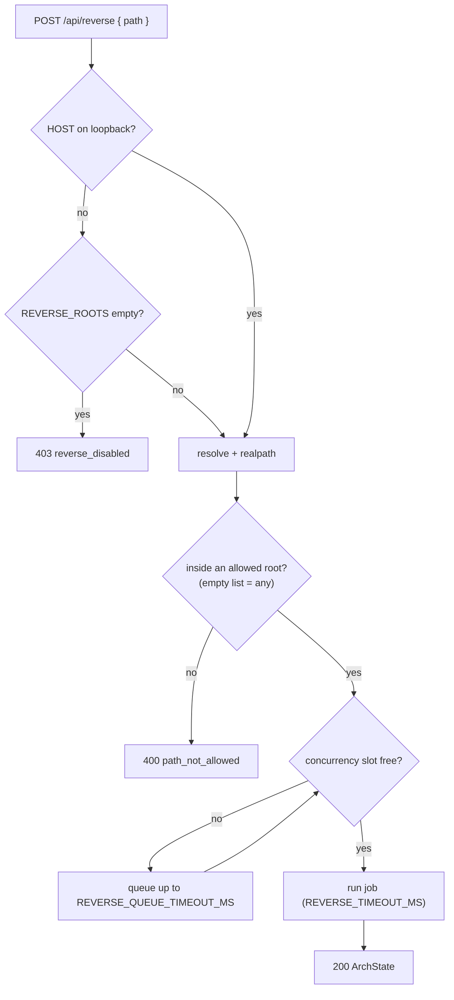

Path resolution uses `path.resolve` + `fs.realpath`: `..` segments are normalized and
symlinks are resolved before comparison, so a symlink inside an allowed root that points
outside is rejected. The resolved path of a rejected target is never returned to the
client. Leaving `REVERSE_ROOTS` empty keeps local use backward compatible (any readable
path), but that combination **closes** once `HOST` leaves loopback: an unauthenticated
endpoint must not read the file system without bounds.

## Deterministic package

ZIP entries are written with a fixed timestamp (`1980-01-01T00:00:00Z`), fixed ordering and
mode `0o644`; `zip.sha256` is computed from the archive bytes and returned in the
`X-Package-SHA256` header. The duration metric in `metrics.json` is zeroed with
`REPRODUCIBLE=1` (or `--reproducible` on the CLI), so two runs produce the same hash:

```bash
pnpm architect --json state.json --out package.zip --reproducible
pnpm architect --reverse . --out package.zip --reproducible
```

## Security posture

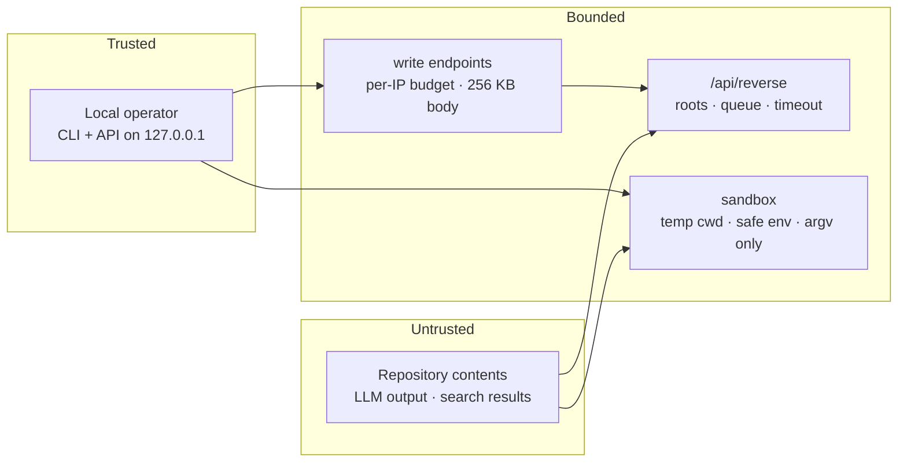

- **Dependencies:** `zod@4.6.7` (patched for GHSA-mrhx-c7xc-m3w5 / CVE-2023-54404) and
  `vitest@5.1.2` (patched for GHSA-82fw-gwwq-j7x9) are pinned; both are the first patched
  lines, so `pnpm audit` no longer reports them.
- **Sandbox execution:** `packages/sandbox` runs commands through `spawn(file, args, {
  shell: false })` only. Arguments are validated as strings, so metacharacters in a command
  name are treated literally instead of being handed to a shell (covered by a test).
- **MCP entry:** `pnpm mcp` starts the stdio server directly with `tsx`; no build step is
  needed, and the handshake is covered by a test.
- **No secrets on disk:** BYOK keys live in the request body only; the generated package
  contains no key material, and sandbox children never inherit API keys.

## Tests

```bash
pnpm test        # nx run-many -t test — 314 tests, 32 files, 8 packages
pnpm typecheck   # nx run-many -t typecheck — 9 projects
pnpm build       # typecheck + test
```

| Package | Tests |
|---|---|
| core | 44 |
| generators | 10 |
| validators | 10 |
| packager | 53 |
| app | 154 |
| reverse | 24 |
| sandbox | 12 |
| mcp | 7 |

Coverage: core/state/diff/task-packet, 8-language i18n, generators, validators, packager,
stream ZIP memory profile, a 54-node stress run + fuzz + concurrent downloads, the HTTP API,
reverse engineering (REA envelope + fake CLI), chat intents, sandbox drivers, web search,
MCP tools and the projects CLI. Contract tests (`packages/app/tests/contract.test.ts`)
validate every endpoint against `packages/app/src/contract.ts`, bind the ZIP headers and
compare the endpoint list in `FRONTEND_SPEC.md` §4 with `ENDPOINTS` in both directions.
Store tests cover the file/memory modes and two worker processes writing one database.

Golden corpus: `examples/corpus/*.json` holds eleven architecture states (single node, 54
nodes, with and without entities, every edge protocol, a legacy state with no `version`
field that migration upgrades, tr/ja/zh titles). `packages/packager/tests/corpus.test.ts`
packages each one reproducibly and compares the file list, every file's SHA-256 and the
numeric metrics against `packages/packager/tests/__snapshots__/corpus.json`. Refresh
intentionally with `UPDATE_CORPUS=1 pnpm nx run packager:test` and commit the snapshot next
to the change that caused it.

## Docker

```bash
docker build -t architect-studio .
docker run --rm -p 3000:3000 -v "$PWD:/workspace" architect-studio
```

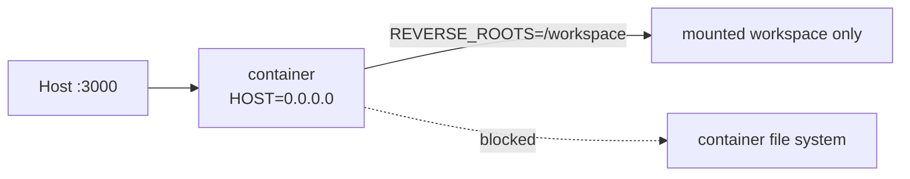

**The image defaults are safe:** `HOST=0.0.0.0` (so the published port is reachable) and
`REVERSE_ROOTS=/workspace`. `/api/reverse` can read only the mounted workspace, so pass
`path: "/workspace/<repo>"` in the request. To widen it, extend `REVERSE_ROOTS`; emptying it
with `-e REVERSE_ROOTS=` makes the server reject reverse with `403 reverse_disabled` because
`HOST` is outside loopback.

`.env.example` keeps the `HOST` line **commented out**, so `docker run --env-file
.env.example` does not force the container onto loopback. Pass a different address/port
explicitly: `-e HOST=0.0.0.0 -e PORT=8080`. A healthcheck is defined against `/api/health`.
Sandbox containers need the Docker/Podman socket passed into the container; `temp-dir` and
`bwrap` do not.

## CI

`.github/workflows/ci.yml`: `typecheck`, `test` and a Docker image build on `.nvmrc`
(Node 24.22.1), installed with `pnpm install --frozen-lockfile`.

## Versioning policy

The version has **one source of truth**: `package.json` → `version`. Everything else is a
projection of it, and the README is updated *from* the code — never the other way around:

| Location | Value | Rule |
|---|---|---|
| `package.json` → `version` | `2.2.0` | Source of truth |
| `packages/app/src/server.ts` → `APP_VERSION` | `2.2.0` | Served by `/`, `/api/health`, `/api/version` |
| `packages/mcp/src/index.ts` → `MCP_SERVER_VERSION` | `2.2.0` | Reported in the MCP handshake |
| This README title, badge and [Tests](#tests) table | follows the code | No independent number |
| `FRONTEND_SPEC.md` response examples | `2.2.0` | Illustrative payloads |
| `packages/*/package.json` | `0.1.0` (`nx-plugin` `0.0.0`) | Private workspace packages; never published, never the release number |

Internal packages stay at `0.1.0` on purpose: they are consumed by relative path, are
`private: true` and are not published, so bumping them would only create a second version
axis to keep in sync. Test counts, Node versions and dependency versions in this README
come from the same policy: they are copied from a real run
(`pnpm typecheck && pnpm test`) and from `package.json`/`.nvmrc`. When they disagree with
the code, the README is wrong — fix the README in the same change.

## Troubleshooting

| Symptom | Cause | Fix |
|---|---|---|
| `rea.engine: "static"` although `rea` is installed | Node outside `^22.23.4 \|\| ^24.22.1 \|\| >=26.12.1` | `pnpm exec node -v`; run through `pnpm` so `devEngines.runtime` applies, or `nvm use` |
| `GET /api/projects` returns `mode: "memory"` | No `ARCHITECT_DB` (library/tests default) | Start with `pnpm start` or set `ARCHITECT_DB` |
| Store flips to memory unexpectedly | The database path is not writable | Check the directory permissions; an unopenable path deliberately falls back |
| `403 reverse_disabled` | Server bound off loopback with an empty `REVERSE_ROOTS` | Set `REVERSE_ROOTS`, or bind `127.0.0.1` |
| `429 reverse_busy` | All `REVERSE_CONCURRENCY` slots busy and the queue timed out | Raise the concurrency or the queue budget |
| `504 reverse_timeout` | A large tree exceeded `REVERSE_TIMEOUT_MS` | Lower `maxFiles`/`maxDepth`, or raise the budget |
| ZIP hash differs between runs | The duration metric is included | Add `--reproducible` / `REPRODUCIBLE=1` |
| `pnpm mcp` exits immediately | stdio client closed the stream, or a stale build was invoked | Run `pnpm mcp` directly; the server needs no build |
| `npm install` created `package-lock.json` | npm always writes its own lockfile | Do not commit it; CI and releases use `pnpm-lock.yaml` |
| Sandbox driver "not installed" | `bwrap`/`podman`/`docker`/`firejail` missing | Use `--sandbox temp-dir`, or enable `fallback` |
| `ExperimentalWarning: SQLite is an experimental feature` | `node:sqlite` prints it at runtime | Expected; it is the reason no native dependency is needed |

## Deliberate limits

- **No authentication or user accounts.** The server is a local, single-operator tool; the
  reverse endpoint is bounded by roots, queue and timeout instead of an identity. Project
  history is global to the database file, not per user.
- **Single process.** Persistence is a SQLite file (WAL) that several processes may write,
  but there is no clustering, migrations framework or remote database.
- **No UI code:** `web/*` was removed and replaced by the `FRONTEND_SPEC.md` contract;
  `GET /` returns an `api-only` welcome JSON when no UI bundle exists.
- Task text is templated per node kind; the LLM only produces the state.
- Acceptance criteria are generated, not executed against the target codebase.
- The sandbox isolates command execution; `podman`/`docker` images must already be pulled.
- There is no browser E2E (Playwright); the download flow is tested at the HTTP level.
- Web search falls back to keyless DuckDuckGo in `auto` mode; result quality depends on the
  provider.
- The `rea` CLI requires Node `^22.23.4 || ^24.22.1 || >=26.12.1`; on older Node the bridge
  falls back to the built-in analyzer (`rea.engine: "static"`).
- The package is installed from source; there is no npm registry publication and therefore
  no `npx architect-studio` entry point.

## Package contents

- `ARCHITECTURE.md` (components + domain model + diagram), `WHITEPAPER.md`, `AGENTS.md`, `.cursorrules`
- `adr/ADR-*.md`
- `TASKS.md` and `tasks/T-*.md` (self-contained task packets)
- `.opencode/agents/{implementer,validator,reviewer}.md`
- `openapi.yaml`, `asyncapi.yaml`, `prisma/schema.prisma`, `diagram.mmd`
- `metrics.json`, `MANIFEST.md`

## Memory profile

The ZIP is produced by piping `JSZip.generateNodeStream` output into a Node `PassThrough`;
the size is measured by a `Writable` that counts without keeping the archive in memory.
`build-package` computes the token metric file by file (it never joins all artifacts into
one string). `packages/packager/tests/memory.test.ts` profiles a 24 MB, incompressible
package in a separate process with `--expose-gc`: live heap stays below half the payload and
no single chunk exceeds 4 MB.

## Metrics

Token counts use a real BPE tokenizer (`gpt-tokenizer`).

| Metric | Target |
|---|---|
| `packet_prompt_tokens_p95` | ≤ 1500 |
| `packet_prompt_tokens_max` | ≤ 2500 |
| `context_slice_ratio` | ≤ 0.10 |
| `duplicate_context_ratio` | ≤ 0.05 |
| `files_per_task` | ≤ 5 |
| `dependency_depth` | ≤ 4 |
| `parallel_groups` | ≥ min(3, node count − 1) |
| `subagent_steps` | ≤ 8 |
| `contract_coverage` | 100% |
| `acceptance_coverage` | 100% |
| `validator_pass_rate` | 100% |
| `deterministic_checks` | ≥ 10 |
| `self_heal_rounds` | ≤ 2 |
| `unresolved_refs` | 0 |
| `deterministic_coverage` | ≥ 90% |
| `index_tokens` | ≤ 800 |
| `package_size_kb` | ≤ 500 |
| `state_to_package_ms` | < 10000 |

## Design and plan

- [`FRONTEND_SPEC.md`](FRONTEND_SPEC.md) — Studio UI contract (screens, design system, API, error states)
- [`docs/state-versioning.md`](docs/state-versioning.md) — `ArchState` version contract and migration
- [`docs/mcp.md`](docs/mcp.md) — MCP tools and client configurations
- [`PROJECT-SUMMARY.md`](PROJECT-SUMMARY.md) — developer handover notes
- [`CONTRIBUTING.md`](CONTRIBUTING.md) — setup, checks and adding packages
- `docs/superpowers/specs/2026-11-22-agent-package-design.md`
- `docs/superpowers/plans/2026-11-22-usable-mvp.md`

## License

MIT — see [`LICENSE`](LICENSE).
