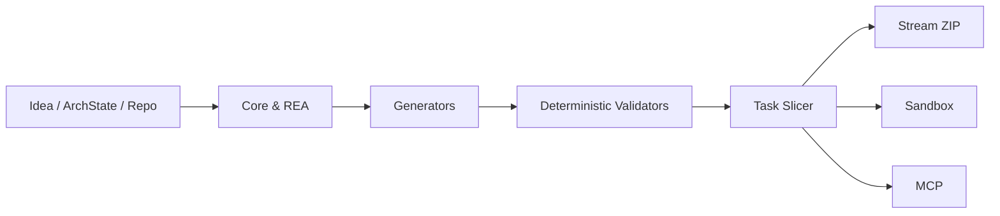

<div align="center">

# AI Principal Architect — v2.1.0

**Turn an idea — or an existing repository — into a verified, low-token agent package that coding agents can build from.**

[](https://github.com/furkanarslangray-design/architect-studio/actions/workflows/ci.yml)
[](.nvmrc)
[](README.md#tests)
[](https://nx.dev)
[](LICENSE)

> **Language / Dil:** [English](README.md) | [Türkçe](README.tr.md)

</div>

An open-source, BYOK-based tool that turns an idea (or an existing project) into a
**verified agent package** that coding agents such as OpenCode, Cursor and Claude can
build from with a low token budget.



## Quick start

```bash
pnpm install
pnpm architect init .   # .architect/config.json + client MCP files + AGENTS.md block
pnpm dev                # nx run app:dev → http://localhost:3000
pnpm test               # nx run-many -t test
pnpm typecheck          # nx run-many -t typecheck
```

## What does it do?

1. Takes a natural-language idea, imports an existing `ArchState` JSON, **or** analyzes an
   existing repository through reverse engineering.
2. Produces the architecture state: components, connections, decisions and **domain entities**.
3. Generates OpenAPI 3.1 (entity CRUD), Prisma, AsyncAPI 2.6, Mermaid, `ARCHITECTURE.md`,
   `WHITEPAPER.md` and ADRs.
4. Validates every artifact deterministically; fixes repairable issues without an LLM.
5. Splits the work into a `TASKS.md` index plus sliced `tasks/T-*.md` packets.
6. Produces the package as a ZIP that **streams with constant memory**.
7. Optionally verifies the package inside an isolated sandbox.
8. Ships it with `.opencode/agents/{implementer,validator,reviewer}.md`, `metrics.json` and
   `MANIFEST.md`.

## v2.0 capabilities

| Capability | Summary |
|---|---|
| **Stream ZIP** | Node `Readable` + backpressure; the archive is never buffered whole. A 24 MB package profile is verified in tests. |
| **8 languages** | `tr`, `en`, `de`, `es`, `fr`, `pt`, `ja`, `zh`; API errors and generated documents follow the selected language. |
| **Studio contract** | No UI code lives in the repo; 11 screens, the component/interaction list, design tokens and the full API contract are in [`FRONTEND_SPEC.md`](FRONTEND_SPEC.md). |
| **REA** | `repoToState`: derives an `ArchState` from `package.json`, workspaces, Prisma, `docker-compose`, ADRs and component files. |
| **Multi-Sandbox** | `temp-dir`, `bwrap`, `podman`, `docker`, `firejail`, `systemd-run`; auto-detection and safe fallback. |
| **MCP** | `architect_generate`, `architect_preview`, `architect_validate`, `architect_reverse_engineer`. |
| **Web search** | Fresh references through Tavily/Brave keys or a keyless DuckDuckGo fallback. |
| **Nx monorepo** | 9 projects, cached `test`/`typecheck` through `nx run-many`, an `nx graph` architecture map and a local `package` generator. |

Demo mode is on by default and needs no API key. Node **24.22.1** (`.nvmrc`) and pnpm 10 are
required; `nvm use` / `fnm use` at the repo root picks the right version.

The server exposes a **HTTP API only**. The Studio UI sources (`web/*`) are not in this
repository; the UI is written separately against the `FRONTEND_SPEC.md` contract. Without a
UI bundle, `GET /` returns `200` + `application/json` — an `api-only` welcome payload with the
name, version, `FRONTEND_SPEC.md` reference and the active `/api/*` routes. Every `GET /api/*`
endpoint works.

### Node version / rea launcher

The `rea-agents` launcher requires Node **`^22.23.4 || ^24.22.1 || >=26.12.1`** in its own
`engines` field; outside those versions the REA bridge does not run and `rea.engine` silently
falls back to `static`. The requirement is therefore pinned at the repository level:

| Location | Value |
|---|---|
| `.nvmrc` | `24.22.1` |
| `package.json` → `engines.node` | `^22.23.4 \|\| ^24.22.1 \|\| >=26.12.1` |
| `.github/workflows/ci.yml` | `actions/setup-node` → `node-version-file: .nvmrc` |

```bash
nvm install && nvm use      # .nvmrc → 24.22.1
node -v                     # v24.22.1
pnpm install                # no engine warning expected
```

If the version does not match, `pnpm install` prints an `Unsupported engine` warning; either
upgrade Node or skip the REA bridge entirely (run without `useRea`, `rea.engine: "static"`).
If your system Node is older and you do not want to upgrade, point
`ARCHITECT_REA_BIN=/path/to/rea` at a launcher that runs under a newer Node.

### BYOK

The client disables demo mode; the API key, model and OpenAI-compatible base URL travel in the
request body (`apiKey`, `model`, `baseUrl`). The key is used only for that request; it is not
written to disk, never logged and never placed in the package.

## UI contract (`FRONTEND_SPEC.md`)

The Studio UI is not part of this repository; its contract is
[`FRONTEND_SPEC.md`](FRONTEND_SPEC.md) at the repo root and the backend is fixed against it:

- **5 sections:** product summary/flows, screen + component/interaction list, design system
  (HEX palette, typography, dark/light, layout, responsive), the full API contract, and error
  and loading states.
- **11 screens/components:** `IdeaComposer`, `ArchitectureCanvas` (Mermaid), `EntityTable`,
  `ChatPanel`, `TaskBoard`, `MetricsGrid`, `ValidationPanel`, `ArtifactExplorer`,
  `ReverseForm`, `SandboxPanel`, `SettingsDrawer`.
- **Endpoints it binds to:** `GET /api/health|version|i18n|sandboxes|rea`,
  `POST /api/preview|chat|generate|reverse|sandbox`.
- The UI needs no new endpoint; the contract matches the existing backend one-to-one.

The architecture chat (`POST /api/chat`) applies natural-language commands (`add Redis cache`,
`add a status field to the Order entity`, `split into microservices`) to the `ArchState`
deterministically; in BYOK mode the LLM takes over and falls back to the deterministic engine
on failure. Field insertion only triggers on an explicit field phrase, a typed identifier or a
camelCase/snake_case identifier — a sentence that merely contains "add" is not treated as a
field. Microservice splitting only runs for `microservice(s)` or a service word plus
`split|böl|ayır`.

## Nx workspace

The repo is a pnpm workspace on Nx 24. Every package has its own `project.json` (`typecheck`,
plus `test` where applicable) and `tsconfig.json`; shared compiler settings live in
`tsconfig.base.json`.

| Project | Role |
|---|---|
| `core` | state, diff, i18n, tokenizer, metrics, task packets |
| `generators` | OpenAPI / Prisma / AsyncAPI / Mermaid / document generators |
| `validators` | deterministic validation + self-heal |
| `packager` | stream ZIP, metrics, manifest, OpenCode agents |
| `app` | pipeline, chat, web search, HTTP server, CLI |
| `reverse` | `repoToState` + morluto/rea bridge |
| `sandbox` | multi-sandbox drivers |
| `mcp` | MCP tools + stdio server |
| `nx-plugin` | local Nx generators (see below) |

```bash
pnpm test                      # nx run-many -t test (cached)
pnpm typecheck                 # nx run-many -t typecheck
pnpm build                     # typecheck + test
pnpm affected                  # nx affected -t typecheck test (defaultBase: main)
pnpm nx graph --host 127.0.0.1 --port 4211   # live project graph
pnpm nx graph --file=graph.html              # static graph output
pnpm nx show projects          # project list
pnpm nx run app:dev            # a single project target
```

`nx.json` sets `useDaemonProcess: false` (CI/container friendly), `analytics: false` and
`cache: true` for the `test`/`typecheck` targets. Task output lives under `.nx/`, which is not
committed.

Because packages import each other by relative path (`../../core/src/state`), Nx does not infer
the dependency edges itself; real dependencies are declared in each `project.json` under
`implicitDependencies`, and the `nx graph` map shows those edges.

### Local Nx generator

`packages/nx-plugin` is an Nx plugin named `@architect-studio/workspace-plugin`
(`generators.json` + a path mapping in `tsconfig.base.json`). It scaffolds a new library
package with the repo's conventions (project.json targets, tsconfig, source, Vitest suite):

```bash
pnpm nx g @architect-studio/workspace-plugin:package order-flow \
  --description="Order flow orchestration"

# Preview: no files are written
pnpm nx g @architect-studio/workspace-plugin:package order-flow --dry-run
```

Generated files: `packages/<name>/project.json`, `packages/<name>/tsconfig.json`,
`packages/<name>/src/index.ts`, `packages/<name>/tests/<name>.test.ts`. Invalid names (not
kebab-case) and existing package names are rejected.

### `architect init`

Connects a target repo to the MCP server in one command:

```bash
pnpm architect init .                     # all clients
pnpm architect init . --client opencode   # a single client
pnpm architect init . --force             # overwrite existing files
```

It writes: `.architect/config.json` (client, MCP command, `reverseRoots`, package/test
runner), `.cursor/mcp.json`, `.mcp.json`, `opencode.json` and the
`<!-- architect:start --> … <!-- architect:end -->` block inside `AGENTS.md`. The command is
**idempotent**: a second run changes nothing (everything reports `unchanged`), it updates only
its own block in `AGENTS.md`, and it never touches files it does not own without `--force`.
For Freebuff it writes no files and leaves a note to add the server from the MCP screen.

### `architect doctor`

Compares the saved architecture (`.architect/state.json`) with the repository as it is today:

```bash
pnpm architect doctor .                  # human-readable report
pnpm architect doctor . --json           # machine-readable report
pnpm architect doctor . --fail-on-drift  # exit 1 on drift (for CI)
pnpm architect doctor . --state out/state.json
pnpm architect doctor . --write          # write today's repo state to .architect/state.json
```

Drift types: `node`, `edge`, `entity`, `field`, `decision` × `added|removed|updated`. A missing
or corrupt state file exits **2**, a clean comparison **0**, and with `--fail-on-drift` drift
exits **1**. `validateState` errors are reported too. Limit: generated `openapi.yaml` /
`ARCHITECTURE.md` are not parsed back; the comparison is structural and the report says so.
`--write` produces the state file (creates it or refreshes it); the typical flow is
`doctor --write` → edit → `doctor --fail-on-drift`.

## Language support (i18n)

The single source is `packages/core/src/i18n/locales/en.ts`; other languages are compiled with
`MessageKey` parity. The `Accept-Language` header, the body `locale` field and the CLI
`--locale` flag all use the same catalog. Missing translations fall back to English and
placeholders are preserved.

## Reverse engineering (REA)

`repoToState(root)` in `packages/reverse` scans:

- root and workspace `package.json` files → framework, database, queue and external services,
- `prisma/schema.prisma` → entities, fields, primary/unique and relations,
- `docker-compose.y(a)ml` / `compose.y(a)ml` → service, database and queue nodes,
- `docs/adr/**`, `adr/**`, `decisions/**` → ADR decisions,
- component files under `src/app|pages|components` → a UI node (when no framework is found).

Directories such as `node_modules`, `.git`, `dist`, `build`, `out`, `coverage`, `vendor`,
`target` and files above 512 KB are skipped. The result is validated with `validateState` and
can be packaged directly. CLI: `--reverse <dir>`, API: `POST /api/reverse`, UI: `ReverseForm`
(`FRONTEND_SPEC.md` §2.2).

### morluto/rea bridge

`--use-rea` (API `useRea: true`, MCP `useRea`) bridges to
[`morluto/rea`](https://github.com/morluto/rea):

- If `rea` or `rea-agents` is on `PATH`, it runs
  `rea analyze-javascript-application <path> --json` (`rea analyze` / `rea inspect` when
  needed); stdout passes through a 54 KB `--filter-output` projection (the full envelope is
  ~34 MB), and REA's `normalized_result` document is converted into module/asset/package/
  endpoint/Electron findings.
- If REA is not installed, the built-in analyzer takes over: file signatures
  (ELF/PE/Mach-O/WASM/SQLite), the Electron `.asar` header, minified bundle signatures,
  `.env.example` key names (values are never read), the Dockerfile base image and external
  endpoints. Findings share the same `evidence` schema, so the layer above never needs to know
  which engine ran.
- Use `ARCHITECT_REA_BIN=/path/to/rea` to point at a specific installation. The `rea-agents`
  launcher requires Node `^22.23.4 || ^24.22.1 || >=26.12.1`; that is why `.nvmrc` (`24.22.1`)
  and `package.json` → `engines.node` pin the same range at the repo root (details:
  [Node version](#node-version--rea-launcher)).
- REA findings merge into the `ArchState` through `mergeReaFindings`: database, queue and
  external-service nodes are added with evidence paths (`props.evidence`); existing names are
  not duplicated.
- The response carries `rea.engine` (`rea` | `rea-agents` | `static`), `rea.findings`,
  `rea.scannedArtifacts` and `rea.warnings` (REA limitations). `GET /api/rea` returns only the
  detection result.

### Incremental reverse (content-hash cache)

`repoToStateCached` keys its result by the hash of the file inventory (path, size, mtime) plus
the SHA-256 content of the files the analyzer actually reads (manifests, Prisma, Compose, ADRs,
`.env.example`, Dockerfile; ≤64 KB) plus the options that affect the result (path base,
`useRea`, `maxFiles`, `maxDepth`, `ignore`). On a hit the result is read from
`.architect/cache/reverse/<key>.json`: manifest parsing, merging, validation and the `rea`
child process are all skipped, and the response reports `cacheHit: true`.

- `POST /api/reverse { cache: false }` bypasses the cache; use `ARCHITECT_CACHE_DIR` for a
  different directory and `REVERSE_CACHE=0` to disable it. TTL is 24 hours.
- When inputs change (manifest content, an added/removed file, options) the key changes and
  the first request recomputes.
- `.architect/cache/` is not committed.
- **Measurement** (this machine, `tsx`): a 391-file fixture (8 Prisma models, Compose, 5 ADRs,
  380 components) went from cold **104.9 ms** to a warm median of **16.3 ms** = **6.4x**; this
  repo (125 files) 60.3 ms → 9.5 ms = 6.3x; editing a manifest recomputes with
  `cacheHit: false`.
- **CPU/RAM optimization** (same fixture): a single directory walk (the pre-scan is reused via
  `inventory`), `mtimeMs` taken from the `stat` result (no second syscall), a content-digest
  memo (4096 entries), an in-process result memo (4 entries) and a `skipped` list capped at
  200 entries. Result: cold **110.5 → 52.9 ms**, warm **18.7 → 5.8 ms**, file reads on the
  warm path **12 → 0**, heap **10–14 MB → 11–13 MB** (flat).

### Progress stream (SSE)

`POST /api/reverse/jobs` takes the same body as `/api/reverse` and returns
`202 { jobId, status, events }`. `GET /api/reverse/jobs/<id>/events` streams
`scan → rea → merge → validate → done|error` as `text/event-stream`; the `done` event's
`payload` is the full `/api/reverse` response. `GET /api/reverse/jobs/<id>` returns the status
and the whole history; finished jobs are kept for 5 minutes. The same queue and security
limits apply.

## Sandbox drivers

`packages/sandbox` exposes a modular `SandboxDriver` interface. Every driver runs the command
in an isolated temporary working directory with only safe environment variables (`PATH`,
`LANG`, `HOME`, `TMPDIR`; API keys never pass through).

| Type | Isolation | Requirement |
|---|---|---|
| `temp-dir` | Directory + restricted env | Always available |
| `bwrap` | Linux namespaces | Bubblewrap |
| `podman` | Rootless container | Podman + a `node:22-alpine` image |
| `docker` | Container | Docker + image |
| `firejail` | Process jail | Firejail |
| `systemd-run` | Transient systemd scope | systemd user session |

The `auto` order is: `bwrap → podman → docker → firejail → systemd-run → temp-dir`. An
explicitly selected driver that is not installed returns a clear error; with `fallback`
enabled it drops to `temp-dir`. CLI `--sandbox <type>` / `--sandbox-command <cmd>`, API
`POST /api/sandbox` and the UI `SandboxPanel` all use the same drivers. `GET /api/sandboxes`
lists the installed engines and their versions.

## MCP server

```bash
pnpm mcp
```

Four tools are exposed over stdio: `architect_generate`, `architect_preview`,
`architect_validate`, `architect_reverse_engineer` (`useRea: true` for the morluto/rea bridge).
Configuration examples for Claude Code, Cursor, OpenCode and Freebuff: [`docs/mcp.md`](docs/mcp.md).

## Web search

An optional search layer runs before `ideaToState`. With provider `auto` it uses
`TAVILY_API_KEY` or `BRAVE_API_KEY` when present, otherwise the keyless DuckDuckGo
instant-answer API. Results are added to the prompt as a context block capped at 4,000
characters. CLI `--web-search --search-provider <auto|tavily|brave|duckduckgo>`, body field
`webSearch: true`, and the `SettingsDrawer`/`IdeaComposer` toggle in the UI
(`FRONTEND_SPEC.md` §2.2).

## HTTP API

| Method | Path | Description |
|---|---|---|
| GET | `/` | `api-only` welcome JSON when no UI is bundled (`name`, `version`, `mode`, `spec`, `endpoints`) |
| GET | `/api/health` | `{ ok, version }` |
| GET | `/api/version` | Version, tokenizer and languages |
| GET | `/api/i18n?locale=tr` | Message catalog |
| GET | `/api/sandboxes` | Detected sandbox drivers |
| POST | `/api/preview` | State + diagram + files + tasks + metrics + validation |
| POST | `/api/generate` | ZIP (`application/zip`, `Content-Length` measured while streaming) |
| GET | `/api/rea` | `rea` / `rea-agents` detection (version, mode) |
| POST | `/api/chat` | `{ state, message }` → updated state, diagram, files, change list |
| POST | `/api/reverse` | `{ path, useRea? }` → `ArchState`, findings, summary, REA report |
| POST | `/api/sandbox` | Verifies the package in the selected sandbox |

Shared body fields: `idea` **or** `state`, `demo`, `apiKey`, `baseUrl`, `model`,
`packageManager`, `testRunner`, `locale`, `sandbox`, `webSearch`. Request bodies are limited
to 256 KB; write endpoints are protected by a per-IP per-minute budget
(`RATE_LIMIT_PER_MIN`, default 120). Error codes: `400` invalid input/state/path/sandbox (and
`path_not_allowed`), `413` body too large, `429` rate limit (and `reverse_busy`), `502` LLM
provider failure, `504` `reverse_timeout`.

### `/api/reverse` security boundaries

The endpoint reads a directory named by the client and has no authentication, so three limits
apply together:

| Limit | Variable | Default | Behavior |
|---|---|---|---|
| Bind address | `HOST` | `127.0.0.1` | Local machine only; a startup warning is printed when bound to the network with an empty `REVERSE_ROOTS` |
| Readable roots | `REVERSE_ROOTS` | *(empty)* | Colon-separated directory list; anything outside gets `400 path_not_allowed` |
| Concurrency | `REVERSE_CONCURRENCY` | `2` | Extra requests wait in a FIFO queue |
| Queue budget | `REVERSE_QUEUE_TIMEOUT_MS` | `30000` | A queued request gets `429 reverse_busy` |
| Job budget | `REVERSE_TIMEOUT_MS` | `120000` | `504 reverse_timeout` on expiry; the same budget is passed to the `rea` child process |

Path resolution uses `path.resolve` + `fs.realpath`: `..` segments are normalized and symlinks
are resolved before comparison, so a symlink inside an allowed root that points outside is
rejected. The resolved path of a rejected target is never returned to the client. Leaving
`REVERSE_ROOTS` empty keeps local use backward compatible (any readable path), but that
combination **closes** once `HOST` leaves loopback: the server rejects the request with
`403 reverse_disabled`, because an unauthenticated endpoint must not read the file system
without bounds. The warning is printed at startup and the rejection at the start of the
request.

### Deterministic package

ZIP entries are written with a fixed timestamp (`1980-01-01T00:00:00Z`), fixed ordering and
mode `0o644`; `zip.sha256` is computed from the archive bytes and returned in the
`X-Package-SHA256` header. The duration metric in `metrics.json` is zeroed with
`REPRODUCIBLE=1` (or `--reproducible` on the CLI), so two runs produce the same hash:

```bash
pnpm architect --json state.json --out package.zip --reproducible
pnpm architect --reverse . --out package.zip --reproducible
```

Tests cover both the `store` and `deflate` profiles, entry dates/modes and identical hashes for
archives produced in separate processes.

## CLI

```bash
# Demo package
pnpm generate -- --idea "Postgres, Redis events, React storefront" --demo

# Package from an existing state + extract to a directory
pnpm generate -- --json examples/architecture.json --out out/package.zip --extract out/package

# Reverse engineering + sandbox verification
pnpm generate -- --reverse ../my-project --use-rea --sandbox auto --out out/reverse.zip

# Turkish output + live web search
pnpm generate -- --idea "..." --demo --locale tr --web-search --search-provider auto

# BYOK + target runtime
pnpm generate -- --idea "..." --api-key sk-... --model gpt-4o-mini \
  --package-manager npm --test-runner jest

# Preview only (writes no ZIP)
pnpm generate -- --json examples/architecture.json --preview
```

Flags: `--out`, `--extract`, `--base-url`, `--sandbox`, `--sandbox-command`, `--web-search`,
`--search-provider`, `--use-rea`, `--help`.

## Package contents

- `ARCHITECTURE.md` (components + domain model + diagram), `WHITEPAPER.md`, `AGENTS.md`, `.cursorrules`
- `adr/ADR-*.md`
- `TASKS.md` and `tasks/T-*.md` (self-contained task packets)
- `.opencode/agents/{implementer,validator,reviewer}.md`
- `openapi.yaml`, `asyncapi.yaml`, `prisma/schema.prisma`, `diagram.mmd`
- `metrics.json`, `MANIFEST.md`

## Memory profile

The ZIP is produced by piping `JSZip.generateNodeStream` output into a Node `PassThrough`; the
size is measured by a `Writable` that counts without keeping the archive in memory.
`build-package` computes the token metric file by file (it never joins all artifacts into one
string). `packages/packager/tests/memory.test.ts` profiles a 24 MB, incompressible package in a
separate process with `--expose-gc`: live heap stays below half the payload and no single chunk
exceeds 4 MB.

## Metrics

Token counts use a real BPE tokenizer (`gpt-tokenizer`).

| Metric | Target |
|---|---|
| `packet_prompt_tokens_p95` | ≤ 1500 |
| `packet_prompt_tokens_max` | ≤ 2500 |
| `context_slice_ratio` | ≤ 0.10 |
| `duplicate_context_ratio` | ≤ 0.05 |
| `files_per_task` | ≤ 5 |
| `dependency_depth` | ≤ 4 |
| `parallel_groups` | ≥ min(3, node count − 1) |
| `subagent_steps` | ≤ 8 |
| `contract_coverage` | 100% |
| `acceptance_coverage` | 100% |
| `validator_pass_rate` | 100% |
| `deterministic_checks` | ≥ 10 |
| `self_heal_rounds` | ≤ 2 |
| `unresolved_refs` | 0 |
| `deterministic_coverage` | ≥ 90% |
| `index_tokens` | ≤ 800 |
| `package_size_kb` | ≤ 500 |
| `state_to_package_ms` | < 10000 |

## Tests

```bash
pnpm test        # nx run-many -t test — 243 tests, 25 files, 8 packages
pnpm typecheck   # nx run-many -t typecheck — 9 projects
pnpm build       # typecheck + test
```

Coverage: core/state/diff/task-packet, 8-language i18n, generators, validators, packager,
stream ZIP memory profile, a 54-node stress run + fuzz + concurrent downloads, the HTTP API,
reverse engineering (REA envelope + fake CLI), chat intents, sandbox drivers, web search and MCP
tools. The `nx-plugin` generator is verified by hand with `nx g ... --dry-run`, a real
generation, `tsc` and Vitest. Contract tests (`packages/app/tests/contract.test.ts`) validate
every endpoint against `packages/app/src/contract.ts`, bind the ZIP headers and compare the
endpoint list in `FRONTEND_SPEC.md` §4 with `ENDPOINTS` in both directions; adding or removing
an endpoint breaks the test.

## Docker

```bash
docker build -t architect-studio .
# Mount the repo at /workspace; the image reads only that path for reverse.
docker run --rm -p 3000:3000 -v "$PWD:/workspace" architect-studio
```

**The image defaults are safe:** `HOST=0.0.0.0` (so the published port is reachable) and
`REVERSE_ROOTS=/workspace`. That means `/api/reverse` can read only the mounted workspace, not
the container's whole file system; pass `path: "/workspace/<repo>"` in the request. To go
outside that equation, widen `REVERSE_ROOTS` or empty it with `-e REVERSE_ROOTS=` — if you
empty it, the server rejects `/api/reverse` with `403 reverse_disabled` because `HOST` is
outside loopback. Network-exposed file reading without an allowlist is not supported; the same
rule applies to non-Docker setups.

`.env.example` keeps the `HOST` line **commented out**, so `docker run --env-file .env.example`
does not force the container onto loopback (a combination that published the port while making
the server unreachable from outside). Pass a different address/port explicitly:
`-e HOST=0.0.0.0 -e PORT=8080`.

A healthcheck is defined against `/api/health`. Sandbox containers need the Docker/Podman
socket passed into the container; `temp-dir` and `bwrap` do not.

## CI

`.github/workflows/ci.yml`: `typecheck`, `test` and a Docker image build on `.nvmrc`
(Node 24.22.1).

## Deliberate limits

- No authentication, users/sessions or persistence; the server is a single in-memory process.
- **No UI code:** `web/*` was removed and replaced by the `FRONTEND_SPEC.md` contract; `GET /`
  returns a `200` `api-only` welcome JSON when no UI bundle exists, and every `/api/*` endpoint
  works.
- Task text is templated per node kind; the LLM only produces the state.
- Acceptance criteria are generated, not executed against the target codebase.
- The sandbox isolates command execution; `podman`/`docker` images must already be pulled.
- There is no browser E2E (Playwright); the download flow is tested at the HTTP level.
- Web search falls back to keyless DuckDuckGo in `auto` mode; result quality depends on the
  provider.
- The `rea` CLI requires Node `^22.23.4 || ^24.22.1 || >=26.12.1`; on older Node the bridge
  falls back to the built-in analyzer (`rea.engine: "static"`). The pinned version lives in
  `.nvmrc` (24.22.1) and `package.json` → `engines.node`; CI reads `.nvmrc` and the Docker image
  is `node:24-alpine`.

## Design and plan

- `FRONTEND_SPEC.md` — Studio UI contract (screens, design system, API, error states)
- `docs/superpowers/specs/2026-11-22-agent-package-design.md`
- `docs/superpowers/plans/2026-11-22-usable-mvp.md`
- `docs/mcp.md` — MCP tools and client configurations
- `PROJECT-SUMMARY.md` — developer handover notes
- `CONTRIBUTING.md` — setup, checks and adding packages
