> **Dil / Language:** [Türkçe](README.tr.md) | [English](README.md)

<div align="center">

# AI Principal Architect — v2.2.0

**Bir fikri — veya mevcut bir depoyu — kodlama ajanlarının düşük token ile inşa edebileceği doğrulanmış bir ajan paketine çevirir.**

[](https://github.com/furkanarslangray-design/architect-studio/actions/workflows/ci.yml)
[](.nvmrc)
[](README.md#tests)
[](https://nx.dev)
[](pnpm-lock.yaml)
[](LICENSE)

</div>

Açık kaynak, BYOK tabanlı bir araç: doğal dildeki bir fikri (veya mevcut bir depoyu)
OpenCode/Cursor/Claude gibi ajanların düşük token bütçesiyle inşa edebileceği
**doğrulanmış bir ajan paketine** dönüştürür.

- **Fikir → mimari → paket.** Tek boru hattı: `ArchState` girer; deterministik
  artifact'lar, görev paketleri ve ZIP çıkar.
- **Yerel öncelikli.** Sunucu varsayılan olarak `127.0.0.1`'e bağlanır; tek ağ çağrısı
  yapılandırdığın LLM isteğidir (demo modunda hiç yok).
- **Bu depoda arayüz kodu yok.** Studio arayüzü [`FRONTEND_SPEC.md`](FRONTEND_SPEC.md)
  sözleşmesine göre ayrı yazılır; bu depo API, CLI, MCP sunucusu ve kütüphanedir.

## İçindekiler

| Bölüm | Ne anlatır |
|---|---|
| [Sistem mimarisi](#sistem-mimarisi) | Parçaların nasıl birleştiği (şemalar) |
| [Gereksinimler ve kurulum](#gereksinimler-ve-kurulum) | Node, pnpm/npm/yarn/bun, tek seferlik kurulum |
| [Hızlı başlangıç](#hızlı-başlangıç) | Gereken beş komut |
| [Boru hattı](#boru-hattı) | Fikirden ZIP'e ne oluyor |
| [CLI](#cli) | Tüm alt komutlar ve bayraklar |
| [HTTP API](#http-api) | Uçlar, gövdeler, hata kodları |
| [Tersine mühendislik](#tersine-mühendislik-rea) | Depo analizi, REA köprüsü, önbellek, SSE |
| [Proje ve revizyonlar](#proje-ve-revizyonlar-sqlite) | Kalıcılık, kilit, `projects` CLI |
| [Sandbox sürücüleri](#sandbox-sürücüleri) | İzole doğrulama |
| [MCP sunucusu](#mcp-sunucusu) | Kodlama ajanları için araçlar |
| [Yapılandırma](#yapılandırma) | Ortam değişkenleri tek tabloda |
| [Testler](#testler) | Neyin doğrulandığı ve nasıl koşulduğu |
| [Güvenlik duruşu](#güvenlik-duruşu) | Sınırlar, bağımlılık düzeltmeleri |
| [Sürüm politikası](#sürüm-politikası) | Sürümün tek kaynağı ve README'nin koda uyması |
| [Sorun giderme](#sorun-giderme) | Bilinen hata kalıpları |

## Sistem mimarisi

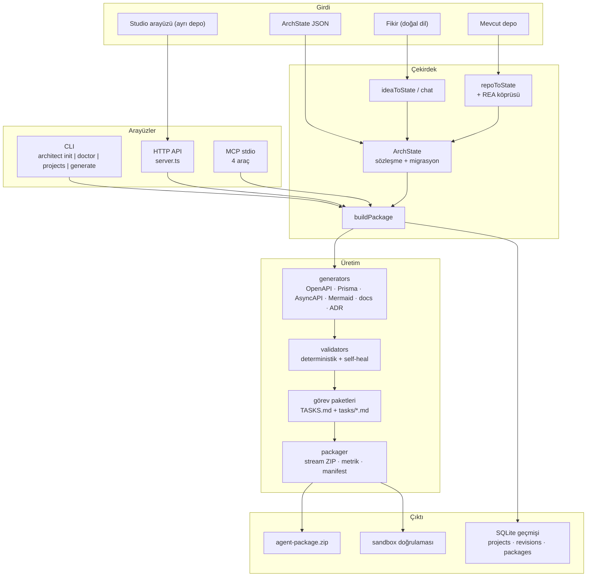

İki arayüz tek boru hattını (`packages/app/src/pipeline.ts`) paylaşır; aynı girdi için CLI
ve HTTP sunucusu bayt bayt aynı paketi üretir.

### İstek yaşam döngüsü

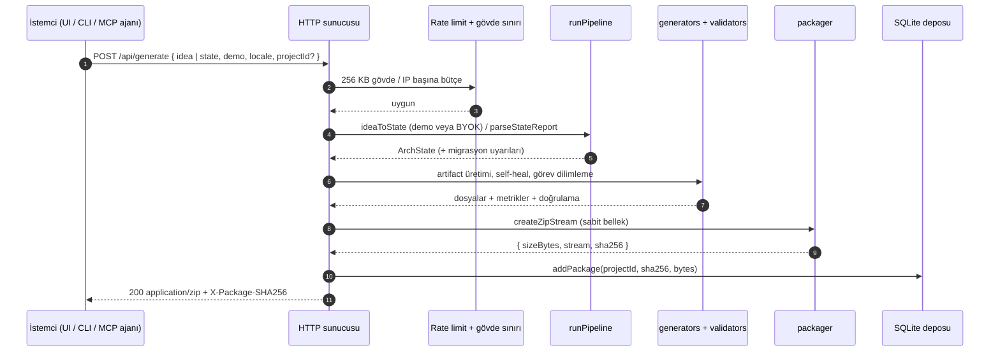

## Gereksinimler ve kurulum

| Gereksinim | Sürüm | Nerede sabit |
|---|---|---|
| Node.js | **24.22.1** | `.nvmrc`, `package.json` → `devEngines.runtime` |
| Node.js aralığı | `^22.23.4 \|\| ^24.22.1 \|\| >=26.12.1` | `package.json` → `engines.node` |
| pnpm | 10 | `pnpm-lock.yaml`, CI (`pnpm/action-setup@v4`) |
| İşletim sistemi | Linux, macOS, Windows | Sandbox sürücüleri isteğe bağlı, otomatik algılanır |

Bu bir **kaynak kopyasıdır**, kayıt defteri paketi değildir: kök `package.json`
`private: true` ve yayınlanan bir `bin` girdisi yoktur, yani klonlayarak kurulur. İki
desteklenen paket yöneticisi yolu vardır.

### pnpm — referans yol

```bash
git clone https://github.com/furkanarslangray-design/architect-studio.git
cd architect-studio
pnpm install            # workspace'i kurar, gerektiğinde sabitlenen Node'u indirir
pnpm exec node -v       # v24.22.1
```

`pnpm`, `pnpm-workspace.yaml` ve `pnpm-lock.yaml` dosyalarını anlayan tek yöneticidir; CI
`pnpm install --frozen-lockfile` çalıştırır. Zorunlu bir nedenin yoksa pnpm kullan.

### npm — mevcut bir kopyayı çalıştırmak için desteklenir

Tüm çalışma ve geliştirme bağımlılıkları **tek kök** `package.json` içindedir;
`packages/*` kendi bağımlılığını bildirmez. Bu düz yerleşim npm'i kullanılabilir kılar:

```bash
git clone https://github.com/furkanarslangray-design/architect-studio.git
cd architect-studio
npm install                       # kökte tek bağımlılık ağacı
npm run --force typecheck         # nx run-many -t typecheck
npm run --force test              # nx run-many -t test
npm run --force dev               # nx run app:dev → http://127.0.0.1:3000
npm run --force architect -- projects list
```

`--force` süs değil, zorunlu: npm 11 `devEngines.runtime` alanını doğrular ve sabitleme
pnpm'e özgü `onFail: "download"` kullanır, bu yüzden düz `npm run <script>` çağrısı
`EBADDEVENGINES` ile durur. `--force` ile script `PATH`'teki `node` altında çalışır — npm
sabitlenen runtime'ı indirmez, REA köprüsü gerekiyorsa önce `nvm use` / `fnm use` çalıştır.
Yukarıdaki komutlar npm 10.9.8 üzerinde `npm install` + `npm run --force typecheck` çıkış
kodu 0 ile doğrulandı.

| pnpm komutu | npm karşılığı |
|---|---|
| `pnpm install` | `npm install` |
| `pnpm dev` / `pnpm start` | `npm run --force dev` / `npm run --force start` |
| `pnpm test` / `pnpm typecheck` | `npm run --force test` / `npm run --force typecheck` |
| `pnpm architect <argüman>` | `npm run --force architect -- <argüman>` |
| `pnpm generate -- <argüman>` | `npm run --force generate -- <argüman>` |
| `pnpm mcp` | `npm run --force mcp` |
| `pnpm nx <hedef>` | `npx nx <hedef>` |

npm yoluyla ilgili notlar:

- Kilit dosyası `pnpm-lock.yaml` olarak kalır. `npm install` bir `package-lock.json`
  yazar; bunu commit etme — depo bir pnpm workspace'idir ve CI pnpm kilidinden kurar.
- npm `devEngines.runtime` alanını zorunlu tutar ama indiremez; bu yüzden yukarıda
  `--force` var. `--force` altında geçerli `node` kullanılır, yani
  `^22.23.4 || ^24.22.1 || >=26.12.1` dışındaki bir sürüm REA köprüsünü sessizce kapatır
  (`rea.engine: "static"`). pnpm'in kullanacağı runtime'ı `pnpm exec node -v` gösterir.
- Yarn ve Bun aynı kök script'leri okur ve `devEngines` indirmesini onlar da uygulamaz;
  devrede olan tek giriş noktaları `tsx` ve `nx` olduğu için davranış npm satırıyla aynıdır.

### Kurulumdan sonra

```bash
pnpm architect init .   # .architect/config.json + istemci MCP dosyaları + AGENTS.md bloğu
cp .env.example .env    # isteğe bağlı: HOST, PORT, ARCHITECT_DB, REVERSE_ROOTS
```

`pnpm architect init .` idempotenttir: ikinci koşu her dosya için `unchanged` raporlar ve
`AGENTS.md` içinde yalnızca kendi `<!-- architect:start --> … <!-- architect:end -->`
bloğunu yeniden yazar.

## Hızlı başlangıç

```bash
pnpm install
pnpm dev                # nx run app:dev → http://127.0.0.1:3000
pnpm test               # nx run-many -t test
pnpm typecheck          # nx run-many -t typecheck
pnpm nx graph --host 127.0.0.1 --port 4211   # canlı proje grafiği
```

Demo modu varsayılan olarak açıktır, API anahtarı gerektirmez. Genellikle ilk işe yarayan
komut şudur:

```bash
pnpm generate -- --idea "Postgres, Redis events, React storefront" --demo --extract out/package
```

Sunucu **yalnızca HTTP API** sunar. Arayüz dosyaları yokken `GET /`, `200` +
`application/json` ile `api-only` karşılama yanıtı döner (ad, sürüm, `FRONTEND_SPEC.md`
referansı, aktif `/api/*` uçları); tüm `/api/*` uçları çalışır.

## Boru hattı

1. **State.** Doğal dildeki fikir `ideaToState` ile, mevcut JSON `parseStateReport` ile
   (migrasyon dahil), depo ise `repoToState` ile `ArchState`'e dönüşür. İsteğe bağlı web
   araması prompt'u zenginleştirir.
2. **Üretim.** Yalnızca state'ten OpenAPI 3.1 (entity CRUD), Prisma, AsyncAPI 2.6, Mermaid
   diagram, `ARCHITECTURE.md`, `WHITEPAPER.md` ve ADR'ler üretilir.
3. **Doğrulama.** Her artifact deterministik kontrol edilir; onarılabilir hatalar LLM'siz
   düzeltilir, kalanlar raporlanır.
4. **Dilimleme.** İş, `TASKS.md` dizini + kendi kendine yeterli `tasks/T-*.md` paketlerine
   ayrılır (bağımlılık dalgaları ve token bütçeleriyle).
5. **Paketleme.** `metrics.json`, `MANIFEST.md`, `.opencode/agents/*.md` ve artifact'lar
   sabit bellekle akan ZIP'e yazılır; hash sabittir.
6. **Doğrulama (isteğe bağlı).** Paket izole bir sandbox sürücüsünde kontrol edilir.

### Yetenekler

| Yetenek | Özet |
|---|---|
| **Stream ZIP** | Node `Readable` + backpressure; arşiv tek buffer'a alınmaz. 24 MB'lık paket profili testte doğrulanır. |
| **8 dil** | `tr`, `en`, `de`, `es`, `fr`, `pt`, `ja`, `zh`; API hataları ve üretilen dokümanlar seçilen dilde. |
| **Studio sözleşmesi** | Arayüz kodu depoda yok; 11 ekran, bileşen/etkileşim listesi, tasarım token'ları ve API sözleşmesi [`FRONTEND_SPEC.md`](FRONTEND_SPEC.md) içinde. |
| **REA** | `repoToState`: `package.json`, workspace'ler, Prisma, `docker-compose`, ADR'ler ve bileşen dosyaları; isteğe bağlı `morluto/rea` köprüsü ikili/bundle bulguları ekler. |
| **Multi-Sandbox** | `temp-dir`, `bwrap`, `podman`, `docker`, `firejail`, `systemd-run`; otomatik algılama ve güvenli fallback. |
| **Projeler** | SQLite tabanlı proje, revizyon ve paket geçmişi; WAL sayesinde birden çok süreç yazabilir. |
| **MCP** | `architect_generate`, `architect_preview`, `architect_validate`, `architect_reverse_engineer`. |
| **Web arama** | Tavily/Brave anahtarıyla veya anahtarsız DuckDuckGo fallback'iyle güncel referanslar. |
| **Nx monorepo** | 9 proje, önbellekli `test`/`typecheck`, `nx graph` mimari haritası, yerel `package` generator'ı. |

### Node sürümü ve rea launcher'ı

`rea-agents` launcher'ı kendi `engines` alanında Node **`^22.23.4 || ^24.22.1 ||
>=26.12.1`** ister; bu aralığın dışında REA köprüsü çalışmaz ve `rea.engine` sessizce
`static`'e düşer. Bu yüzden gereksinim depo seviyesinde sabitlendi:

| Yer | Değer |
|---|---|
| `.nvmrc` | `24.22.1` |
| `package.json` → `engines.node` | `^22.23.4 \|\| ^24.22.1 \|\| >=26.12.1` |
| `package.json` → `devEngines.runtime` | `node 24.22.1` |
| `.github/workflows/ci.yml` | `actions/setup-node` → `node-version-file: .nvmrc` |

```bash
pnpm install                # gerekirse sabitlenen runtime'ı da indirir
pnpm exec node -v           # v24.22.1 — script'ler her zaman proje runtime'ını kullanır
```

Sistem `node`'u eski olsa bile `pnpm <script>` 24.22.1 ile çalışır; REA köprüsü makine
genelindeki Node değişmeden çalışır. İkisi de mümkün değilse REA köprüsünü atla
(`useRea` verme, `rea.engine: "static"`) veya `ARCHITECT_REA_BIN=/path/to/rea` ile
desteklenen Node altında çalışan bir launcher göster.

### BYOK

İstemci demo modunu kapatır; API anahtarı, model ve OpenAI-uyumlu base URL istek gövdesinde
(`apiKey`, `model`, `baseUrl`) gönderilir. Anahtar yalnızca o istek için kullanılır; diske
yazılmaz, loglanmaz ve pakete konmaz.

## CLI

```bash
pnpm architect init [dir] [--client cursor|claude|opencode|freebuff|all] [--force]
pnpm architect doctor [dir] [--state <path>] [--json] [--fail-on-drift] [--write]
pnpm architect projects list|show|save|restore [--db <path>]
pnpm generate -- --idea "<metin>" [bayraklar]
```

### `architect init`

Hedef repoyu tek komutla MCP sunucusuna bağlar ve `.architect/config.json` (istemci, MCP
komutu, `reverseRoots`, paket/test çalıştırıcı), `.cursor/mcp.json`, `.mcp.json`,
`opencode.json` ve `AGENTS.md` içindeki kendi bloğunu yazar. Sahibi olmadığı dosyalara
`--force` verilmeden dokunmaz. Freebuff için dosya yazmaz, MCP ekranından ekleme notu düşer.

### `architect doctor`

Kaydedilmiş mimari (`.architect/state.json`) ile deponun bugünkü hâlini karşılaştırır.
Drift türleri: `node`, `edge`, `entity`, `field`, `decision` × `added|removed|updated`.
State dosyası yoksa/bozuksa çıkış **2**, temizse **0**, `--fail-on-drift` ile kayma varsa
**1**. Üretilmiş `openapi.yaml`/`ARCHITECTURE.md` geri ayrıştırılmaz; karşılaştırma
yapısaldır ve rapor bunu not eder. Tipik akış: `doctor --write` → düzenle →
`doctor --fail-on-drift`.

### `architect generate`

```bash
pnpm generate -- --idea "Postgres, Redis events, React storefront" --demo
pnpm generate -- --json examples/architecture.json --out out/package.zip --extract out/package
pnpm generate -- --reverse ../my-project --use-rea --sandbox auto --out out/reverse.zip
pnpm generate -- --idea "..." --demo --locale tr --web-search --search-provider auto
pnpm generate -- --idea "..." --api-key sk-... --model gpt-4o-mini \
  --package-manager npm --test-runner jest
pnpm generate -- --json examples/architecture.json --preview
```

| Bayrak | Anlamı |
|---|---|
| `--idea <metin>` | Doğal dildeki mimari fikri |
| `--json <yol>` | Mevcut `ArchState` dosyasını içe aktarır |
| `--reverse <dizin>` | State'i depodan çıkarır |
| `--use-rea` | Kuruluysa `morluto/rea` köprüsünü kullanır |
| `--out <yol>` | Çıktı ZIP'i (varsayılan `out/agent-package.zip`) |
| `--extract <dizin>` | Paket dosyalarını ayrıca dizine yazar |
| `--preview` | State, görevler, metrikler ve doğrulamayı JSON olarak basar |
| `--demo` | API anahtarı gerektirmeyen deterministik üretim |
| `--api-key`, `--base-url`, `--model` | BYOK ayarları; diske yazılmaz |
| `--package-manager` | Üretilen paket için `pnpm \| npm \| yarn \| bun` (varsayılan `pnpm`) |
| `--test-runner` | `vitest \| jest \| node` (varsayılan `vitest`) |
| `--locale` | `tr \| en \| de \| es \| fr \| pt \| ja \| zh` |
| `--sandbox`, `--sandbox-command` | Doğrulama sürücüsü ve özel komut |
| `--web-search`, `--search-provider` | Üretim öncesi referans araması |
| `--reproducible` | Süre metriğini sıfırlar, böylece hash'ler koşular arası aynı olur |

`--package-manager npm` **üretilen** paket için önemlidir: görev paketleri pnpm yerine
`npm install` / `npm test` komutlarını gösterir. Değer hedefe göre belgelenir, böylece alt
ajan yöneticileri karıştırmaz.

## HTTP API

| Yöntem | Yol | Açıklama |
|---|---|---|
| GET | `/` | Arayüz yokken `api-only` karşılama JSON'u (`name`, `version`, `mode`, `spec`, `endpoints`) |
| GET | `/api/health` | `{ ok, version }` |
| GET | `/api/version` | Sürüm, tokenizer ve diller |
| GET | `/api/i18n?locale=tr` | Mesaj kataloğu |
| GET | `/api/sandboxes` | Algılanan sandbox sürücüleri |
| POST | `/api/preview` | State + diyagram + dosyalar + görevler + metrikler + doğrulama |
| POST | `/api/generate` | ZIP (`application/zip`, `Content-Length` akıştan ölçülür) |
| GET | `/api/rea` | `rea` / `rea-agents` algılama sonucu |
| POST | `/api/chat` | `{ state, message }` → güncel state, diyagram, dosyalar, değişiklikler |
| POST | `/api/reverse` | `{ path, useRea? }` → `ArchState`, bulgular, özet, REA raporu |
| POST | `/api/reverse/jobs` | `/api/reverse` ile aynı gövde; `202 { jobId, status, events }` |
| GET | `/api/reverse/jobs/{id}` | İş durumu ve tüm olay geçmişi |
| GET | `/api/reverse/jobs/{id}/events` | `text/event-stream`: `scan → rea → merge → validate → done\|error` |
| GET | `/api/projects` | Projeler ve revizyon sayıları (`mode: file\|memory`) |
| POST | `/api/projects` | `{ name }` → `201 { project }` |
| GET | `/api/projects/{id}` | Proje, revizyon geçmişi ve paket sayısı |
| POST | `/api/projects/{id}/revisions` | `{ state, message? }` → `201 { revision }` |
| GET | `/api/projects/{id}/revisions` | Revizyon geçmişi, yeniden eskiye (state yok) |
| POST | `/api/projects/{id}/restore/{revisionId}` | Revizyonu yeni bir revizyon olarak geri yükler |
| POST | `/api/sandbox` | Paketi seçilen sandbox'ta doğrular |

Ortak gövde alanları: `idea` **veya** `state`, `demo`, `apiKey`, `baseUrl`, `model`,
`packageManager`, `testRunner`, `locale`, `sandbox`, `webSearch`. Gövde 256 KB ile
sınırlıdır; yazma uçları IP başına dakikalık bütçeyle korunur (`RATE_LIMIT_PER_MIN`,
varsayılan 120).

| Kod | Anlamı |
|---|---|
| `400` | Geçersiz girdi, state, yol veya sandbox (`path_not_allowed`, `invalid_name` dahil) |
| `403` | `reverse_disabled` — ağa açık bağlanmada sınırsız reverse |
| `413` | Gövde çok büyük |
| `429` | Rate limit veya `reverse_busy` kuyruk zaman aşımı |
| `502` | LLM sağlayıcı hatası |
| `504` | `reverse_timeout` |

### State migrasyon uyarıları

Eski state'ler `parseStateReport` ile yükseltilir; uyarılar kaybolmaz: `/api/preview`,
`/api/chat` ve `/api/sandbox` bunları `stateWarnings` içinde, `/api/generate`
`X-State-Warnings` başlığında döner (ZIP aktığı için JSON gövde yoktur), CLI ise
`State migration: …` satırını stderr'e yazar; böylece `--preview` JSON'u stdout'ta makine
tarafından okunabilir kalır.

## Tersine mühendislik (REA)

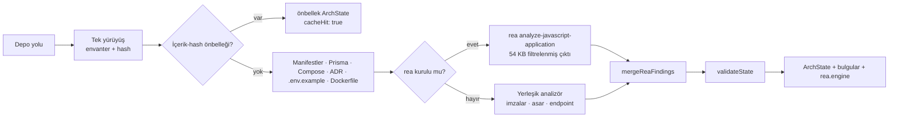

`repoToState(root)` şunları tarar: kök/workspace `package.json` (framework, veritabanı,
kuyruk, dış servisler), `prisma/schema.prisma` (entity, alan, primary/unique, ilişki),
`docker-compose.y(a)ml`/`compose.y(a)ml` (servis, veritabanı, kuyruk), `docs/adr/**`,
`adr/**`, `decisions/**` (ADR kararları) ve `src/app|pages|components` (framework yoksa UI
düğümü). `node_modules`, `.git`, `dist`, `build`, `out`, `coverage`, `vendor`, `target` ve
512 KB üstü dosyalar atlanır.

### morluto/rea köprüsü

- `rea` veya `rea-agents` PATH'te varsa `rea analyze-javascript-application <path> --json`
  çalıştırılır; stdout 54 KB'lık `--filter-output` projeksiyonundan geçer (tam zarf
  ~34 MB) ve `normalized_result` dokümanı bulgulara çevrilir.
- Kurulu değilse yerleşik analizör devreye girer: dosya imzaları (ELF/PE/Mach-O/WASM/
  SQLite), Electron `.asar` başlığı, minified bundle imzaları, `.env.example` anahtar
  adları (değerler okunmaz), Dockerfile tabanı ve dış endpoint'ler. Bulgular aynı `evidence`
  şemasındadır.
- `ARCHITECT_REA_BIN=/path/to/rea` belirli bir kurulumu gösterir.
- REA büyük ağaçlarda yavaştır: iki dosyalık fixture ~6,5 sn (`rea` motoru, 6.10.1); bu depo
  (153 dosya) 5 dakikalık bütçeyi aştı. Büyük hedeflerde `maxFiles`/`maxDepth` küçük tut;
  köprü `REVERSE_TIMEOUT_MS` değerini `rea` alt sürecine geçirir.
- Yanıt `rea.engine` (`rea` | `rea-agents` | `static`), `rea.findings`,
  `rea.scannedArtifacts` ve `rea.warnings` taşır.

### Artımlı reverse (içerik-hash önbelleği)

`repoToStateCached` sonucu dosya envanterinin (yol, boyut, mtime) + analizörün okuduğu
dosyaların SHA-256 içeriğinin (manifestler, Prisma, Compose, ADR, `.env.example`,
Dockerfile; ≤64 KB) + sonucu etkileyen seçeneklerin hash'iyle anahtarlar. İsabet durumunda
sonuç `.architect/cache/reverse/<key>.json` dosyasından okunur; parse, merge, doğrulama ve
`rea` alt süreci atlanır, yanıtta `cacheHit: true` döner. `cache: false` önbelleği atlar,
`ARCHITECT_CACHE_DIR` dizini değiştirir, `REVERSE_CACHE=0` kapatır; TTL 24 saattir.

Ölçüm (bu makine, `tsx`): 391 dosyalık fixture cold **104,9 ms** → warm medyan
**16,3 ms** = 6,4x; bu depo (125 dosya) 60,3 ms → 9,5 ms = 6,3x. CPU/RAM optimizasyonu
sonrası soğuk **110,5 → 52,9 ms**, sıcak **18,7 → 5,8 ms**, sıcak yolda dosya okuması
**12 → 0**.

### İlerleme akışı (SSE)

`POST /api/reverse/jobs` gövdesi `/api/reverse` ile aynıdır ve `202 { jobId, status,
events }` döner. `GET /api/reverse/jobs/<id>/events` `text/event-stream` olarak
`scan → rea → merge → validate → done|error` akıtır; `done` olayının `payload` alanı tam
`/api/reverse` yanıtıdır. Biten işler 5 dakika saklanır; aynı kuyruk ve güvenlik sınırları
geçerlidir.

## Proje ve revizyonlar (SQLite)

`packages/app/src/store.ts` projeleri, revizyonları ve üretilen paketleri saklar; bir oturum
kaldığı yerden açılabilir. `better-sqlite3` yerine yerleşik `node:sqlite` (`DatabaseSync`)
kullanılır: yeni bağımlılık ve native derleme yok, sabitlenen Node aralığı modülü zaten
içerir.

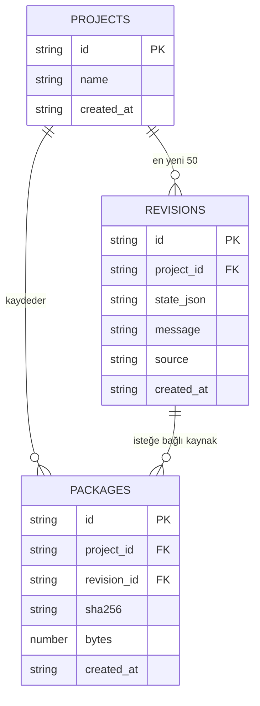

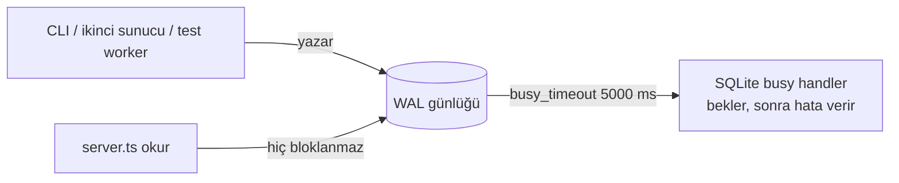

- `ARCHITECT_DB=/yol/architect.db` dosyayı açar; `pnpm start` / `pnpm dev` varsayılan olarak
  `.architect/architect.db` kullanır. Değişken yoksa (kütüphane ve testler) depo bellekte
  kalır ve `GET /api/projects` `mode: "memory"` döner.
- Açılamayan bir yol istekleri düşürmek yerine belleğe düşer.
- `POST /api/generate` gövdesinde `projectId` (isteğe bağlı `revisionId`) varsa ZIP'in
  `sha256` ve bayt boyutu projeye kaydedilir.
- **Eşzamanlı yazıcılar:** veritabanı `journal_mode = WAL`, `synchronous = NORMAL`,
  `busy_timeout = 5000` ile açılır. Bekleme SQLite'ın kendi busy handler'ına bırakılır —
  JavaScript tarafında retry döngüsü yoktur, yani kilit çakışmasının tek bir bakılacak yeri
  vardır. Bir test aynı dosyaya onar revizyon ekleyen iki worker süreci başlatır ve yirmisini
  de bekler.
- `projects` CLI:

```bash
pnpm architect projects list
pnpm architect projects show <projectId>
pnpm architect projects save <projectId> state.json --message "db ekle"
pnpm architect projects restore <projectId> <revisionId>
pnpm architect projects list --db /tmp/baska.sqlite   # ARCHITECT_DB'yi geçersiz kılar
```

`save` yeni revizyon kimliğini, `restore` geri yüklenen state JSON'unu, `list`
`id<TAB>revizyonSayısı<TAB>ad` biçimini yazar. Çıkış kodları `doctor` ile aynıdır: `0`
başarı, `1` kullanım hatası, `2` eksik/geçersiz girdi.

## Sandbox sürücüleri

`packages/sandbox` modüler bir `SandboxDriver` arayüzü sunar. Her sürücü komutu izole bir
geçici çalışma dizininde, yalnızca güvenli ortam değişkenleriyle (`PATH`, `LANG`, `HOME`,
`TMPDIR`; API anahtarları geçmez) çalıştırır. Komutlar `spawn(file, args, { shell: false })`
ile çalışır, yani argümandaki metakarakterler kabuğa gitmez.

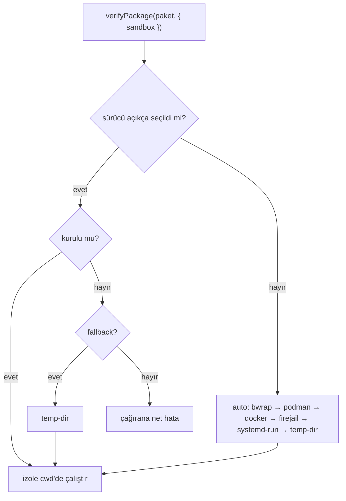

| Tür | İzolasyon | Gereksinim |
|---|---|---|
| `temp-dir` | Dizin + kısıtlı env | Her zaman kullanılabilir |
| `bwrap` | Linux namespace | Bubblewrap |
| `podman` | Rootless konteyner | Podman + `node:22-alpine` imajı |
| `docker` | Konteyner | Docker + imaj |
| `firejail` | Süreç jail'i | Firejail |
| `systemd-run` | Geçici systemd scope | systemd kullanıcı oturumu |

CLI `--sandbox <tür>` / `--sandbox-command <cmd>`, API `POST /api/sandbox` ve arayüzdeki
`SandboxPanel` aynı sürücüleri kullanır. `GET /api/sandboxes` kurulu motorları ve
sürümlerini listeler. Sürüm sorgusu bir sağlık kontrolüdür: 2 sn ile sınırlıdır ve zaman
aşımında tüm süreç ağacı (POSIX süreç grubu) öldürülür; kurulu ama asılan bir ikili isteği
veya test koşusunu bekletmek yerine kendini kullanılamaz olarak bildirir.

## MCP sunucusu

```bash
pnpm mcp
```

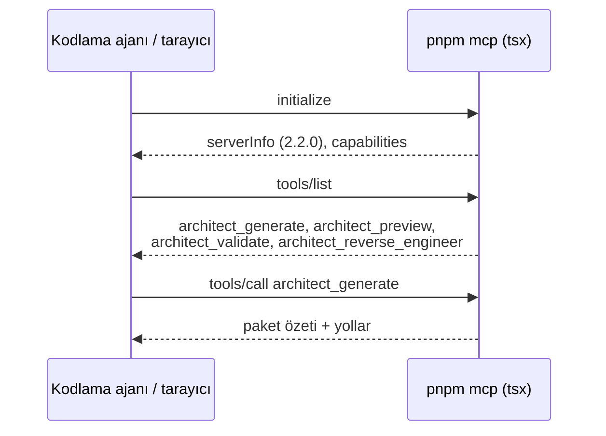

Dört araç stdio üzerinden sunulur. `pnpm mcp` sunucuyu doğrudan `tsx` ile başlatır; ek
build adımı yoktur ve bir test gerçek `initialize` + `tools/list` el sıkışmasını `pnpm mcp`
üzerinden yapar. Claude Code, Cursor, OpenCode ve Freebuff yapılandırma örnekleri:
[`docs/mcp.md`](docs/mcp.md).

## Web araması

`ideaToState`'ten önce isteğe bağlı bir arama katmanı çalışır. Sağlayıcı `auto` iken
`TAVILY_API_KEY` veya `BRAVE_API_KEY` varsa o servis, yoksa anahtarsız DuckDuckGo
instant-answer API'si kullanılır. Sonuçlar 4.000 karakterle sınırlı bir bağlam bloğu olarak
prompt'a eklenir. CLI `--web-search --search-provider <auto|tavily|brave|duckduckgo>`, API
gövdesinde `webSearch: true`.

## Dil desteği (i18n)

Tek kaynak `packages/core/src/i18n/locales/en.ts`; diğer diller `MessageKey` parity'siyle
derlenir. `Accept-Language` başlığı, gövdedeki `locale` alanı ve CLI `--locale` aynı
kataloğu kullanır. Eksik çeviri İngilizceye düşer, placeholder'lar korunur.

## Çalışma alanı yerleşimi

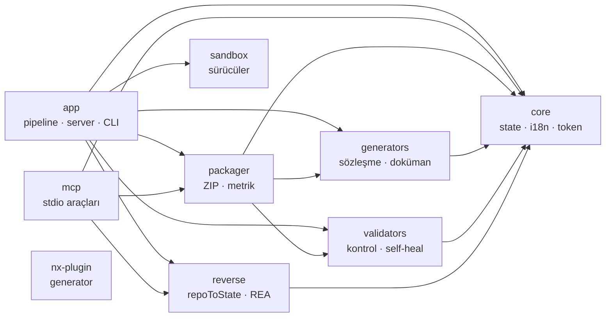

| Proje | Rol |
|---|---|
| `core` | state, diff, i18n, tokenizer, metrikler, task packet |
| `generators` | OpenAPI / Prisma / AsyncAPI / Mermaid / doküman üreticileri |
| `validators` | deterministik doğrulama + self-heal |
| `packager` | stream ZIP, metrikler, manifest, OpenCode ajanları |
| `app` | pipeline, sohbet, web arama, HTTP sunucusu, CLI |
| `reverse` | `repoToState` + morluto/rea köprüsü |
| `sandbox` | çoklu sandbox sürücüleri |
| `mcp` | MCP araçları + stdio sunucusu |
| `nx-plugin` | yerel Nx generator'ları |

```bash
pnpm test                      # nx run-many -t test (önbellekli)
pnpm typecheck                 # nx run-many -t typecheck
pnpm build                     # typecheck + test
pnpm affected                  # nx affected -t typecheck test (defaultBase: main)
pnpm nx graph --host 127.0.0.1 --port 4211   # canlı proje grafiği
pnpm nx graph --file=graph.html              # statik grafik çıktısı
pnpm nx show projects          # proje listesi
pnpm nx run app:dev            # tek proje hedefi
```

`nx.json` içinde `useDaemonProcess: false`, `analytics: false` ve `test`/`typecheck`
hedefleri için `cache: true` ayarlıdır; görev çıktıları `.nx/` altında tutulur ve git'e
girmez. Paketler birbirini göreli yolla import ettiği için Nx bağımlılık kenarlarını
kendiliğinden çıkarmaz; gerçek bağımlılıklar `project.json` içindeki
`implicitDependencies` alanında bildirilir ve yukarıdaki şema bunları yansıtır.

### Yerel Nx generator'ı

`packages/nx-plugin`, `@architect-studio/workspace-plugin` adıyla bir Nx plugin'idir ve yeni
kütüphane paketini depo kurallarıyla üretir:

```bash
pnpm nx g @architect-studio/workspace-plugin:package order-flow \
  --description="Order flow orchestration"
pnpm nx g @architect-studio/workspace-plugin:package order-flow --dry-run  # dosya yazmaz
```

Üretilen dosyalar: `packages/<ad>/project.json`, `packages/<ad>/tsconfig.json`,
`packages/<ad>/src/index.ts`, `packages/<ad>/tests/<ad>.test.ts`. Geçersiz ad (kebab-case
değil) ve var olan paket adı reddedilir.

## Yapılandırma

| Değişken | Varsayılan | Amaç |
|---|---|---|
| `HOST` | `127.0.0.1` | Bağlanma adresi; ağa açık bağlanma + boş `REVERSE_ROOTS` uyarır ve reverse'i kapatır |
| `PORT` | `3000` | HTTP portu |
| `ARCHITECT_DB` | yok (bellek) / `pnpm dev`·`pnpm start` için `.architect/architect.db` | Projeler ve revizyonlar için SQLite dosyası |
| `ARCHITECT_CACHE_DIR` | `.architect/cache` | Reverse önbellek dizini |
| `REVERSE_CACHE` | açık | `0` reverse önbelleğini kapatır |
| `REVERSE_ROOTS` | boş | `/api/reverse` için iki nokta ayrımlı izin listesi |
| `REVERSE_CONCURRENCY` | `2` | Paralel reverse işi; fazlası FIFO kuyruğa girer |
| `REVERSE_QUEUE_TIMEOUT_MS` | `30000` | Kuyruk bütçesi; aşımda `429 reverse_busy` |
| `REVERSE_TIMEOUT_MS` | `120000` | İş bütçesi; aşımda `504 reverse_timeout`, `rea`'ya da geçer |
| `RATE_LIMIT_PER_MIN` | `120` | IP başına yazma bütçesi |
| `ARCHITECT_REA_BIN` | otomatik | Açık `rea` launcher yolu |
| `TAVILY_API_KEY`, `BRAVE_API_KEY` | yok | Web arama sağlayıcıları (`auto` DuckDuckGo'ya düşer) |
| `REPRODUCIBLE` | yok | `1` süre metriğini sıfırlar, hash sabitlenir |
| `UPDATE_CORPUS` | yok | `1` paketleyici altın anlık görüntüsünü testte tazeler |

### `/api/reverse` güvenlik sınırları

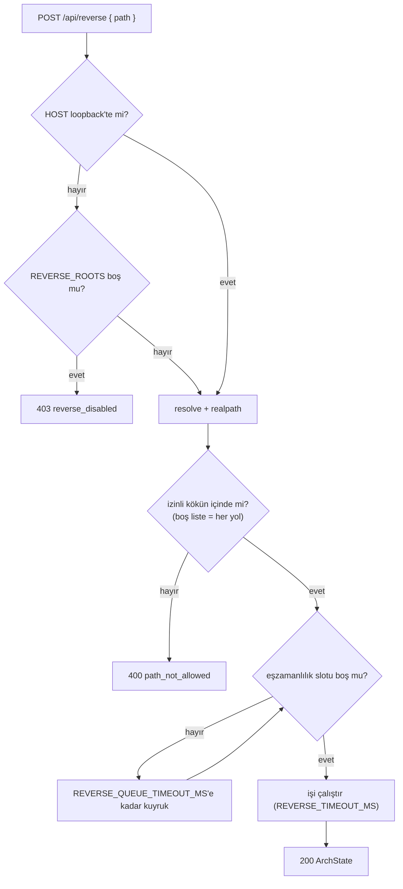

Yol çözümlemesi `path.resolve` + `fs.realpath` ile yapılır: `..` segmentleri normalize
edilir, sembolik bağlantılar çözüldükten sonra karşılaştırılır, yani izinli kök içindeki bir
symlink dışarıyı gösteriyorsa reddedilir. Reddedilen yolların çözümlenmiş hâli istemciye
döndürülmez. `REVERSE_ROOTS` boş bırakılırsa yerel kullanım geriye uyumludur, ama `HOST`
loopback dışına alındığında bu kombinasyon kapanır: kimlik doğrulaması olmayan bir uç dosya
sistemini sınırsız okumamalıdır.

## Deterministik paket

ZIP girdileri sabit zaman damgası (`1980-01-01T00:00:00Z`), sabit sıralama ve `0o644` modu
ile yazılır; `zip.sha256` arşiv baytlarından hesaplanır ve `X-Package-SHA256` başlığında
döner. `metrics.json` içindeki süre metriği `REPRODUCIBLE=1` (veya `--reproducible`) ile
sıfırlanır, böylece iki koşu aynı hash'i verir:

```bash
pnpm architect --json state.json --out paket.zip --reproducible
pnpm architect --reverse . --out paket.zip --reproducible
```

## Güvenlik duruşu

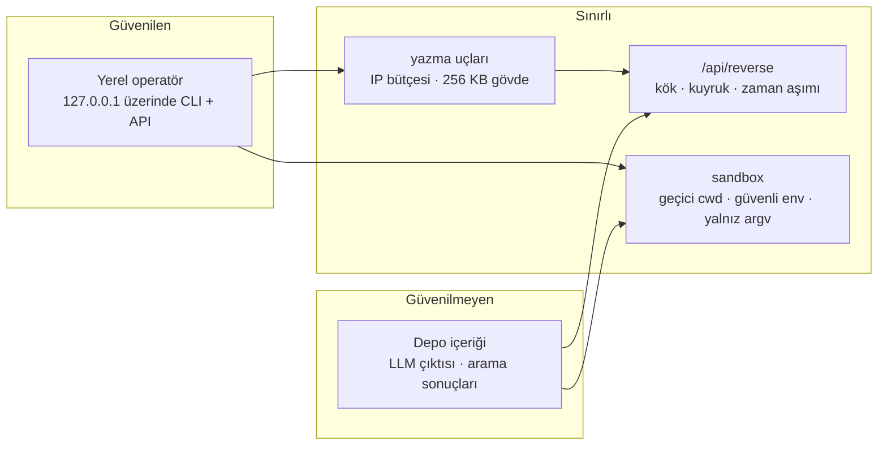

- **Bağımlılıklar:** `zod@4.6.7` (GHSA-mrhx-c7xc-m3w5 / CVE-2023-54404 için yamalı) ve
  `vitest@5.1.2` (GHSA-82fw-gwwq-j7x9 için yamalı) sabitlendi; ikisi de ilk yamalı sürüm
  çizgisi, `pnpm audit` artık bunları raporlamıyor.
- **Sandbox çalıştırma:** yalnızca `spawn(file, args, { shell: false })`; argümanlar string
  olarak doğrulanır, komut adındaki metakarakterler kabuğa değil argv'ye gider (testle
  doğrulandı).
- **MCP girişi:** `pnpm mcp` stdio sunucusunu doğrudan `tsx` ile başlatır; ek build adımı
  yoktur ve el sıkışma bir testle kapsanır.
- **Diske sır yazılmaz:** BYOK anahtarı yalnızca istek gövdesindedir; üretilen pakete sır
  girmez, sandbox alt süreçleri API anahtarlarını devralmaz.

## Testler

```bash
pnpm test        # nx run-many -t test — 338 test, 41 dosya, 8 paket
pnpm typecheck   # nx run-many -t typecheck — 9 proje
pnpm build       # typecheck + test
```

| Paket | Test |
|---|---|
| core | 44 |
| generators | 10 |
| validators | 10 |
| packager | 53 |
| app | 176 |
| reverse | 26 |
| sandbox | 12 |
| mcp | 7 |

Kapsam: core/state/diff/task-packet, 8 dilli i18n, generator'lar, doğrulayıcılar, packager,
stream ZIP bellek profili, 54 düğümlü stres + fuzz + eşzamanlı indirme, HTTP API, tersine
mühendislik (REA zarfı + sahte CLI), sohbet niyetleri, sandbox sürücüleri, web arama, MCP
araçları ve `projects` CLI. Sözleşme testleri (`packages/app/tests/contract.test.ts`) her
ucu `packages/app/src/contract.ts` şemasına karşı doğrular, ZIP başlıklarını bağlar ve
`FRONTEND_SPEC.md` §4'teki uç listesini `ENDPOINTS` ile iki yönlü karşılaştırır. Store
testleri dosya/bellek modlarını ve tek veritabanına yazan iki worker sürecini kapsar.

### Modül sınırları

Paketler yalnızca genel giriş noktalarından import edilir (`@architect-studio/core`,
`…/generators`, `…/packager`, `…/validators`, `…/reverse`, `…/sandbox`):
`tsconfig.base.json` her adı `packages/<pkg>/src/index.ts` dosyasına eşler, `vitest.config.ts`
aynı eşlemeyi testler için yineler. `project.json` dosyalarındaki `implicitDependencies`
kaldırıldı. `packages/app/tests/module-boundaries.test.ts` eslint bağımlılığı olmadan üç
kuralı uygular: derin import (`@architect-studio/core/src/diff`) yasak, paketler arası göreli
import (`../../core/src/…`) yasak ve uygulamalar `type:tooling` paketine bağlanamaz.

### Eval koşum takımı

`pnpm eval` API anahtarı olmadan commit'lenmiş model kayıtlarını oynatır; CI kaliteyi
deterministik ölçer:

```bash
pnpm eval            # examples/evals/recordings/*.json oynat (varsayılan)
pnpm eval --record   # yapılandırılmış modeli çağır (BYOK) ve kayıtları yenile
pnpm eval --dir examples/evals
```

`examples/evals/*.json` içindeki her vaka `id`, `idea` ve beklentileri (`minNodes`,
`minEntities`, `minDecisions`) tanımlar. Rapor vaka başına geçti/kaldı, geçerli state oranı,
deterministik motora düşme oranı (kayıt deterministik çıktıyla birebir aynıysa) ve state
başına ortalama token verir. Eksik kayıt atlanmaz, açık hata verir. Aynı koşu `app:eval` Nx
hedefi olarak da var.

Altın korpus: `examples/corpus/*.json` on bir mimari state tutar (tek düğüm, 54 düğüm,
entity'li/entity'siz, her edge protokolü, migrasyonla yükseltilen `version`'sız eski state,
tr/ja/zh başlıklar). `packages/packager/tests/corpus.test.ts` her birini tekrarlanabilir
şekilde paketler ve dosya listesini, her dosyanın SHA-256'sını ve sayısal metrikleri
`packages/packager/tests/__snapshots__/corpus.json` ile karşılaştırır. Bilinçli tazeleme:
`UPDATE_CORPUS=1 pnpm nx run packager:test`; yeni anlık görüntüyü nedeniyle birlikte commit et.

## Web arayüzü

Studio kabuğu üç statik dosya olarak gelir (`web/index.html`, `web/styles.css`,
`web/app.js`); derleme adımı yoktur, `GET /` doğrudan bu dosyayı sunar ve CSP
`default-src 'self'` kalır. On hash yönlendirmeli görünüm composer, mimari (Mermaid),
sohbet, görevler, kalite, artifact'lar, reverse (SSE ilerleme), sandbox, ayarlar ve
durum ekranlarını kapsar; sekiz dilli katalog `GET /api/i18n`'den gelir, tema
`prefers-color-scheme` ve `architect.theme` ile yönetilir, BYOK anahtarı yalnızca
bellekteki bir değişkende tutulur — storage, çerez veya URL'e yazılmaz.
`packages/app/tests/web-ui.test.ts` servis sözleşmesini, palet token'larını ve kabuğun
kullandığı her API yolunun var olduğunu doğrular;
`packages/app/tests/readme-diagrams.test.ts` README'lerdeki her Mermaid bloğunu jsdom
altında gerçek renderer ile parse eder.

## Docker

```bash
docker build -t architect-studio .
docker run --rm -p 3000:3000 -v "$PWD:/workspace" architect-studio
```

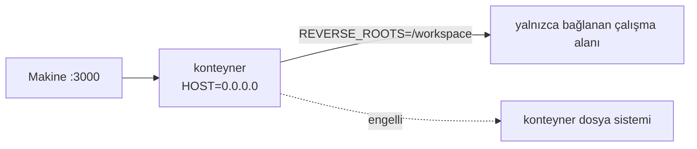

**İmaj varsayılanları güvenli:** `HOST=0.0.0.0` (yayınlanan porta erişim için) ve
`REVERSE_ROOTS=/workspace`. Yani `/api/reverse` konteynerin tüm dosya sistemini değil,
yalnızca bağlanan çalışma alanını okur; istekte `path: "/workspace/<repo>"` verilir.
`REVERSE_ROOTS`'u boşaltırsan (`-e REVERSE_ROOTS=`) sunucu `HOST` loopback dışında olduğu
için reverse'i `403 reverse_disabled` ile reddeder.

`.env.example` `HOST` satırını **yorumda** tutar, böylece `docker run --env-file
.env.example` konteyneri loopback'e zorlamaz. Farklı adres/port için açıkça geç:
`-e HOST=0.0.0.0 -e PORT=8080`. `/api/health` üzerinden healthcheck tanımlıdır. Sandbox
konteynerleri için Docker/Podman soketi verilmelidir; `temp-dir` ve `bwrap` bunu gerektirmez.

## CI

`.github/workflows/ci.yml`: `.nvmrc` (Node 24.22.1) ile `typecheck`, `test` ve Docker image
build; kurulum `pnpm install --frozen-lockfile` ile yapılır.

## Sürüm politikası

Sürümün **tek kaynağı** `package.json` → `version`'dır. Diğer her şey onun izdüşümüdür ve
README koddan güncellenir, tersi değil:

| Yer | Değer | Kural |
|---|---|---|
| `package.json` → `version` | `2.2.0` | Tek kaynak |
| `packages/app/src/server.ts` → `APP_VERSION` | `2.2.0` | `/`, `/api/health`, `/api/version` tarafından sunulur |
| `packages/mcp/src/index.ts` → `MCP_SERVER_VERSION` | `2.2.0` | MCP el sıkışmasında bildirilir |
| Bu README başlığı, rozetler ve [Testler](#testler) tablosu | kodu izler | Bağımsız sürüm numarası yok |
| `FRONTEND_SPEC.md` yanıt örnekleri | `2.2.0` | Örnek payload |
| `packages/*/package.json` | `0.1.0` (`nx-plugin` `0.0.0`) | Özel workspace paketleri; yayınlanmaz, sürüm numarası değildir |

İç paketler bilinçli olarak `0.1.0` kalır: göreli yolla tüketilirler, `private: true`'dır ve
yayınlanmazlar; onları yükseltmek yalnızca eşitlenmesi gereken ikinci bir sürüm ekseni
yaratırdı. Test sayıları, Node ve bağımlılık sürümleri de aynı politikaya uyar: gerçek bir
`pnpm typecheck && pnpm test` koşusundan ve `package.json`/`.nvmrc`'den kopyalanır. Kodla
çeliştiklerinde yanlış olan README'dir — aynı değişiklikte README düzeltilir.

## Sorun giderme

| Belirti | Neden | Çözüm |
|---|---|---|
| `rea` kurulu olduğu hâlde `rea.engine: "static"` | Node `^22.23.4 \|\| ^24.22.1 \|\| >=26.12.1` dışında | `pnpm exec node -v`; script'leri `pnpm` ile çalıştır ki `devEngines.runtime` uygulansın, ya da `nvm use` |
| `GET /api/projects` `mode: "memory"` dönüyor | `ARCHITECT_DB` yok (kütüphane/test varsayılanı) | `pnpm start` kullan veya `ARCHITECT_DB` ver |
| Depo beklenmedik şekilde belleğe düşüyor | Veritabanı yolu yazılabilir değil | Dizin izinlerini kontrol et; açılamayan yol bilinçli olarak belleğe düşer |
| `403 reverse_disabled` | Loopback dışına bağlanma + boş `REVERSE_ROOTS` | `REVERSE_ROOTS` ver veya `127.0.0.1`'e bağlan |
| `429 reverse_busy` | Tüm `REVERSE_CONCURRENCY` slotları dolu ve kuyruk zaman aşımına düştü | Eşzamanlılığı veya kuyruk bütçesini artır |
| `504 reverse_timeout` | Büyük ağaç `REVERSE_TIMEOUT_MS`'i aştı | `maxFiles`/`maxDepth` küçült ya da bütçeyi artır |
| Koşular arası ZIP hash'i farklı | Süre metriği hash'e giriyor | `--reproducible` / `REPRODUCIBLE=1` ekle |
| `pnpm mcp` hemen çıkıyor | stdio istemcisi akışı kapattı veya eski build çağrıldı | `pnpm mcp`'yi doğrudan çalıştır; build gerekmez |
| `npm run <script>` `EBADDEVENGINES` ile düşüyor | npm `devEngines.runtime` alanını doğrular; `onFail: "download"` pnpm'e özgüdür | `npm run --force <script>` kullan ya da sabitlenen runtime için pnpm'e geç |
| `npm install` `package-lock.json` oluşturdu | npm kendi kilit dosyasını her zaman yazar | Commit etme; CI ve sürümler `pnpm-lock.yaml` kullanır |
| Sandbox sürücüsü "not installed" | `bwrap`/`podman`/`docker`/`firejail` yok | `--sandbox temp-dir` kullan veya `fallback` etkinleştir |
| `ExperimentalWarning: SQLite is an experimental feature` | `node:sqlite` çalışma zamanında basar | Beklenen; native bağımlılık gerekmemesinin nedeni bu |

## Bilinçli sınırlar

- **Kimlik doğrulama ve kullanıcı hesabı yok.** Sunucu yerel, tek operatörlü bir araçtır;
  reverse ucu kimlik yerine kök/kuyruk/zaman aşımı ile sınırlanır. Proje geçmişi veritabanı
  dosyasına aittir, kullanıcı başına değildir.
- **Tek süreç.** Kalıcılık, birden çok sürecin yazabildiği bir SQLite (WAL) dosyasıdır;
  kümeleme, migrasyon çerçevesi veya uzak veritabanı yoktur.
- **Arayüz kodu yoktur:** `web/*` silindi, yerine `FRONTEND_SPEC.md` sözleşmesi geçti;
  `GET /` arayüz yokken `api-only` karşılama JSON'u döner.
- Görev metinleri node türüne göre şablonlanır; LLM yalnızca state üretir.
- Kabul kriterleri üretilir, hedef kod tabanında çalıştırılmaz.
- Sandbox komut çalıştırma izolasyonu sağlar; `podman`/`docker` imajı önceden çekilmiş
  olmalıdır.
- Tarayıcı E2E (Playwright) yoktur; indirme akışı HTTP seviyesinde test edilir.
- Web araması `auto` modunda anahtarsız DuckDuckGo'ya düşer; kalite sağlayıcıya bağlıdır.
- `rea` CLI'ı Node `^22.23.4 || ^24.22.1 || >=26.12.1` ister; eski Node'da köprü yerleşik
  analizöre düşer (`rea.engine: "static"`).
- Paket kaynaktan kurulur; npm kayıt defteri yayını ve dolayısıyla `npx architect-studio`
  giriş noktası yoktur.

## Paket içeriği

- `ARCHITECTURE.md` (bileşenler + domain modeli + diagram), `WHITEPAPER.md`, `AGENTS.md`, `.cursorrules`
- `adr/ADR-*.md`
- `TASKS.md` ve `tasks/T-*.md` (kendi kendine yeterli görev paketleri)
- `.opencode/agents/{implementer,validator,reviewer}.md`
- `openapi.yaml`, `asyncapi.yaml`, `prisma/schema.prisma`, `diagram.mmd`
- `metrics.json`, `MANIFEST.md`

## Bellek profili

ZIP, `JSZip.generateNodeStream` çıktısının Node `PassThrough`'a köprülenmesiyle üretilir;
boyut, arşivi belleğe almadan sayan bir `Writable` ile ölçülür. `build-package` token
metriğini dosya dosya hesaplar. `packages/packager/tests/memory.test.ts` 24 MB'lık,
sıkıştırılamayan bir paketi `--expose-gc` ile ayrı süreçte profiller: canlı heap yükün
yarısının altında kalır, tek parça 4 MB'ı geçmez.

## Metrikler

Token sayımı gerçek BPE tokenizer (`gpt-tokenizer`) ile yapılır.

| Metrik | Hedef |
|---|---|
| `packet_prompt_tokens_p95` | ≤ 1500 |
| `packet_prompt_tokens_max` | ≤ 2500 |
| `context_slice_ratio` | ≤ 0.10 |
| `duplicate_context_ratio` | ≤ 0.05 |
| `files_per_task` | ≤ 5 |
| `dependency_depth` | ≤ 4 |
| `parallel_groups` | ≥ min(3, düğüm sayısı − 1) |
| `subagent_steps` | ≤ 8 |
| `contract_coverage` | 100% |
| `acceptance_coverage` | 100% |
| `validator_pass_rate` | 100% |
| `deterministic_checks` | ≥ 10 |
| `self_heal_rounds` | ≤ 2 |
| `unresolved_refs` | 0 |
| `deterministic_coverage` | ≥ 90% |
| `index_tokens` | ≤ 800 |
| `package_size_kb` | ≤ 500 |
| `state_to_package_ms` | < 10000 |

## Tasarım ve plan

- [`FRONTEND_SPEC.md`](FRONTEND_SPEC.md) — Studio arayüzü sözleşmesi
- [`docs/state-versioning.md`](docs/state-versioning.md) — `ArchState` sürüm sözleşmesi ve migrasyon
- [`docs/mcp.md`](docs/mcp.md) — MCP araçları ve istemci yapılandırmaları
- [`PROJECT-SUMMARY.md`](PROJECT-SUMMARY.md) — geliştirici devir notu
- [`CONTRIBUTING.md`](CONTRIBUTING.md) — kurulum, kontroller ve paket ekleme
- `docs/superpowers/specs/2026-11-22-agent-package-design.md`
- `docs/superpowers/plans/2026-11-22-usable-mvp.md`

## Lisans

Apache License 2.0 — bkz. [`LICENSE`](LICENSE). Telif 2026 Architect Studio katkıcıları.
Lisans patent hakkı (bölüm 3) tanır ve değiştirilen dosyaların belirgin değişiklik notu
taşımasını ister (bölüm 4b).
